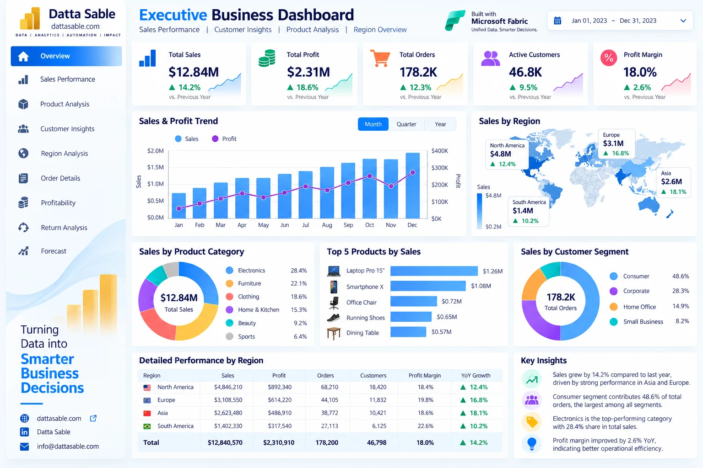
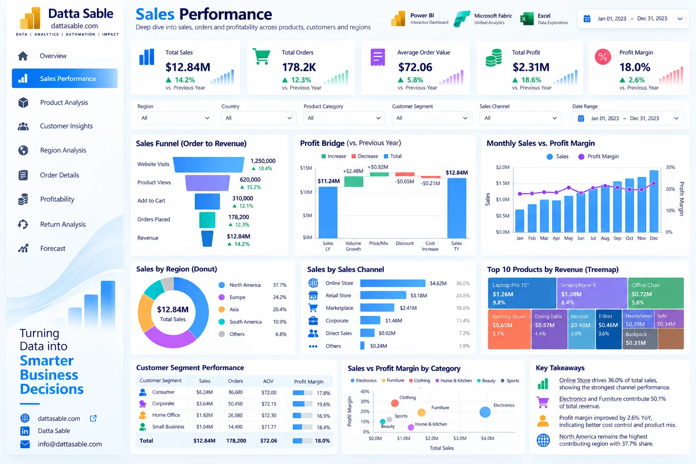
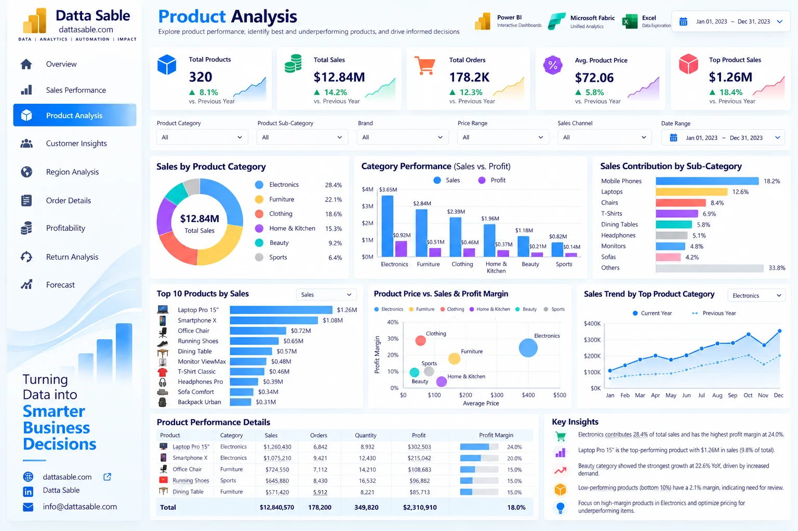
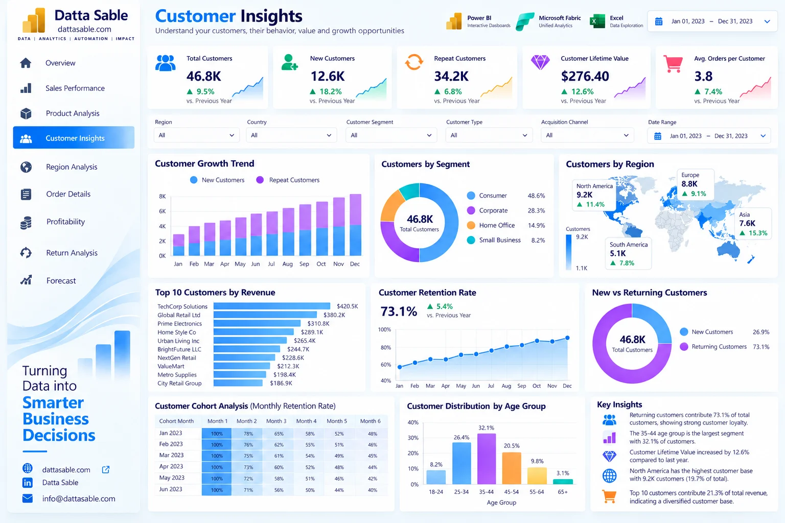
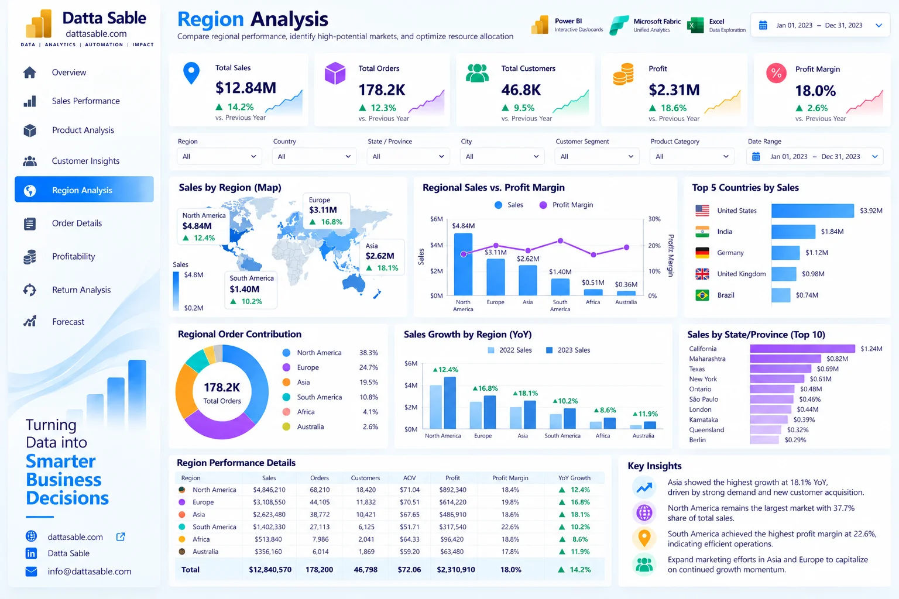
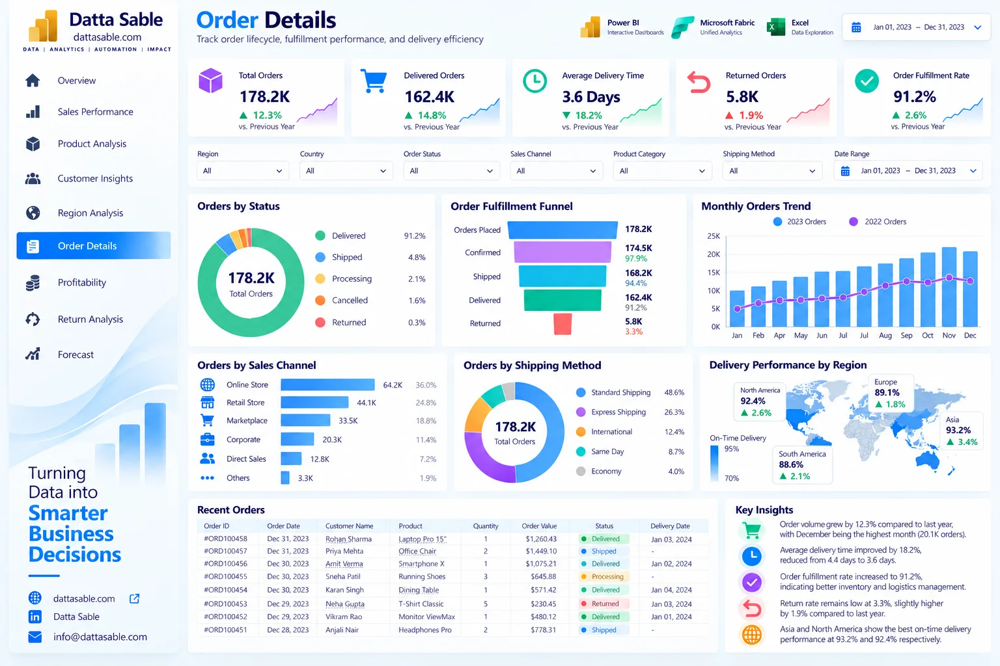
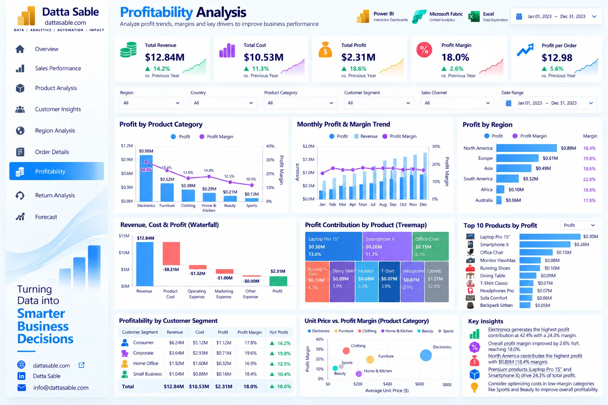
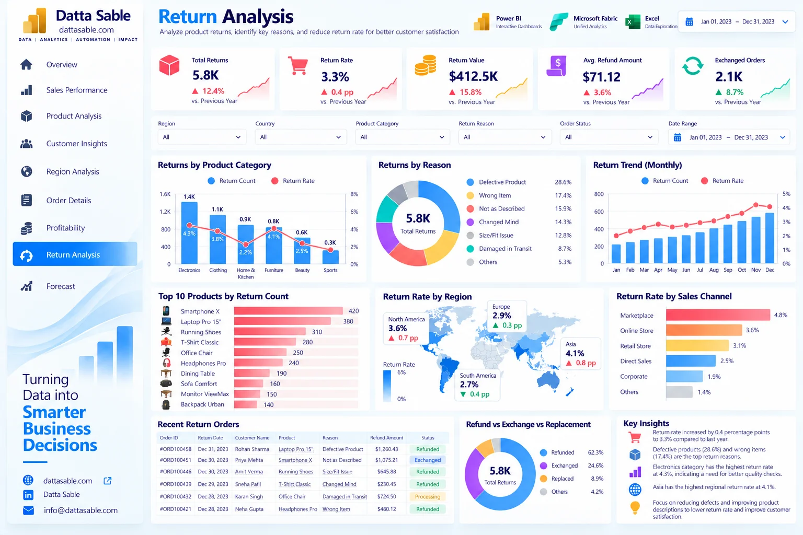
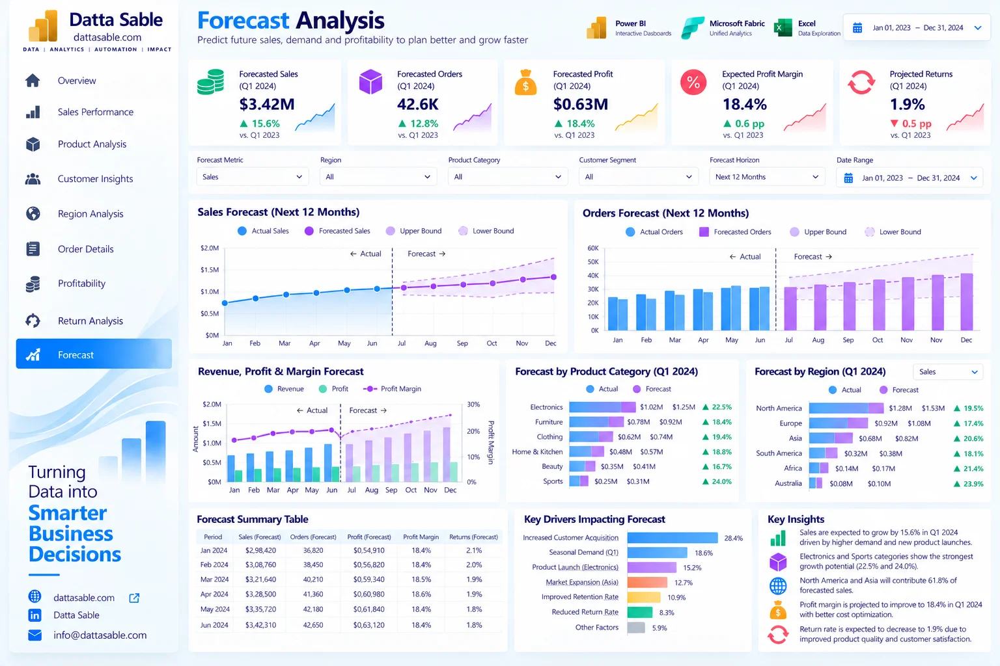
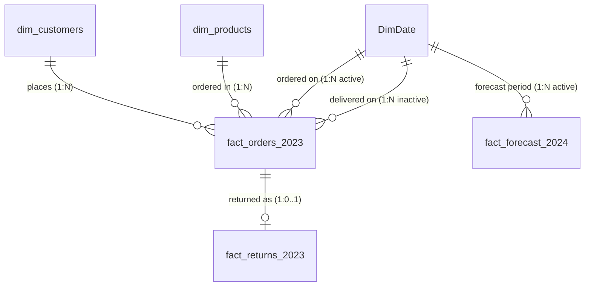

<div align="center">


# Enterprise Power BI Analytics Portfolio
### Nine Dashboard Design References with Reproducible Data, DAX, and Implementation Resources

[](https://powerbi.microsoft.com/)
[](dax/)
[](data/)
[](docs/validation-report.md)
[](releases/v1.0.0/)
[](LICENSE)
[](https://dattasable.com)

**Author:** [Datta Sable](https://dattasable.com) &nbsp;|&nbsp; **Portfolio:** [dattasable.com](https://dattasable.com) &nbsp;|&nbsp; **Contact:** [info@dattasable.com](mailto:info@dattasable.com) &nbsp;|&nbsp; **LinkedIn:** [Connect on LinkedIn](https://www.linkedin.com/in/) <!-- Configuration item: Repository owner to provide verified personal LinkedIn handle (e.g. https://www.linkedin.com/in/dattasable) -->

</div>

---

## 📌 Executive Summary

The **Enterprise Power BI Analytics Portfolio** is an open, production-grade business intelligence architecture and portfolio reference project. It showcases modern multi-page analytical reporting, star-schema data modeling, robust DAX engineering, automated data validation, and executive presentation standards calibrated to Microsoft Fabric design patterns.

Built on an omnichannel retail enterprise dataset of **231,130 records across 5 relational tables** modeling **$12.84M in annual gross sales**, this project provides a complete blueprint for how enterprise BI teams design, document, reconcile, and validate commercial intelligence solutions.

> [!NOTE]
> **Authenticity & Transparency Guarantee:**  
> The dashboard images provided in this repository are **high-fidelity visual design references and architectural wireframes**, not screenshots of an active compiled `.pbix` report. All underlying transactional and dimensional data is reproducible synthetic demonstration data calibrated for 100% mathematical reconciliation. Complete schema definitions, Power Query transformations, 66 DAX measures, and visual build guides are provided to construct the interactive reports from scratch in Power BI Desktop or Microsoft Fabric.

---

## 🎯 What This Project Demonstrates

This repository represents end-to-end expertise across the full modern business intelligence life cycle:

- **Business KPI Definition:** Translation of executive business goals into formal commercial metrics (Gross Sales, Direct Merchandise Cost / COGS, Gross Operating Profit, Margin %, AOV, Repeat Purchase Rate, Return Rate, and Refund Liability).
- **Analytical Data Modeling:** Star schema architecture separating numerical transactional fact events (`fact_orders`, `fact_returns`, `fact_forecast_2024`) from core business entities (`dim_customers`, `dim_products`, `DimDate`).
- **Relational Dataset Preparation:** Clean, typed synthetic datasets spanning 231,130 records with 100% referential integrity and zero primary key collisions.
- **DAX Measure Engineering:** A modular library of **66 production DAX measures** featuring safe division (`DIVIDE`), active/inactive date relationship activation (`USERELATIONSHIP`), customer cohort iteration, and cumulative time intelligence.
- **Power Query Methodology:** Documented M-code ETL transformations, data type enforcement, calendar table generation, and dimensional attribute derivations.
- **Financial Reconciliation:** Mathematical precision audited to the penny (`Sales $12.84M - Cost $10.53M = Profit $2.31M` with $0.00 variance; `Return Rate 3.25%`).
- **Data Quality Validation:** Automated Python verification engines and GitHub Actions CI pipelines executing automated unit tests on schemas, foreign keys, and financial totals.
- **Executive Dashboard Design:** Clean information hierarchy, standard 16:9 1080p canvas grids, cohesive Microsoft Fabric light-mode color tokens, and accessibility standards.
- **Business Reporting Documentation:** Comprehensive technical documentation including an 11-sheet master Excel handbook, visual build matrices, and data dictionaries.
- **Forecast Scenario Analysis:** 2024 baseline trend projections accompanied by illustrative scenario planning sensitivity bounds (Conservative -12% / Optimistic +12%).
- **GitHub Project Organization:** Professional open-source repository management featuring versioned release archives, SHA-256 manifests, least-privilege CI workflows, and documentation cross-reference verification.

---

## ⏱️ For Recruiters and Hiring Managers (5-Minute Review Guide)

Reviewing this project takes approximately five minutes. Here is the suggested evaluation roadmap:

1. **View the Executive Overview:** Review the [Featured Dashboard Preview](#-featured-dashboard-preview) to evaluate visual hierarchy, KPI card layout, and executive UX design.
2. **Explore the 9 Dashboard Designs:** Scan the [9-Page Dashboard Gallery](#️-9-page-dashboard-gallery) to assess reporting breadth across Sales, Products, Customers, Regions, Logistics, Profitability, Returns, and Projections.
3. **Inspect the DAX Measure Library:** Review [`docs/dax-validation-matrix.md`](docs/dax-validation-matrix.md) and [`dax/measures/`](dax/measures/) for DAX coding standards, variable usage, and filter context management.
4. **Review the Relational Dataset:** Examine [`data/data-dictionary.md`](data/data-dictionary.md) and [`docs/data-model.md`](docs/data-model.md) to inspect star-schema cardinality and dimensional normalization.
5. **Check the Validation Evidence:** Read [`docs/validation-report.md`](docs/validation-report.md) and inspect `.github/workflows/validate.yml` to see automated CI data testing in action.
6. **Inspect the Implementation Guide:** Browse [`excel/powerbi-implementation-handbook.xlsx`](excel/powerbi-implementation-handbook.xlsx) and [`docs/getting-started.md`](docs/getting-started.md) for step-by-step reproduction instructions.

**Contact Datta Sable directly:**
- 🌐 **Portfolio Website:** [dattasable.com](https://dattasable.com)
- ✉️ **Email:** [info@dattasable.com](mailto:info@dattasable.com)
- 💼 **LinkedIn Profile:** [Connect on LinkedIn](https://www.linkedin.com/in/) <!-- Configuration item: Repository owner to provide verified personal LinkedIn handle -->

---

## 🚀 Coming from LinkedIn? Start Here.

Welcome! If you discovered this project via LinkedIn, here is everything you need in one place:

- 📊 **Explore Dashboard Designs:** View the [9-Page Visual Gallery](#️-9-page-dashboard-gallery) below, with each page linking to its visual build matrix.
- 💾 **Download Clean Datasets:** Access the [5 relational CSV files in `data/raw/`](data/raw/) or download the [Release v1.0.0 Datasets ZIP Pack](https://github.com/sabledattatray/enterprise-power-bi-dashboard/releases).
- 📐 **Copy Verified DAX Measures:** Browse [66 ready-to-copy DAX formulas](dax/) with business definitions, filter context rules, and formatting standards.
- 📘 **Review the Excel Handbook:** Inspect [`excel/powerbi-implementation-handbook.xlsx`](excel/powerbi-implementation-handbook.xlsx) containing data dictionaries, relationships, and visual build matrices.
- 🎨 **Grab Vector SVG Icons:** Download [85 custom SVG icons across 12 categories](assets/icons/) for navigation bars and KPI cards.
- 🛠️ **Build Your Own Report:** Follow the [24-Step Reproducible Build Guide](docs/getting-started.md).

### 📋 LinkedIn Copy-and-Share Summary
```text
Excited to share the Enterprise Power BI Analytics Portfolio by Datta Sable! 🚀
Features 9 multi-page dashboard designs, a 231,130-row relational retail dataset ($12.84M sales), 66 DAX measures, star-schema modeling, and an 85-piece SVG icon library. Fully reproducible and open-source!

Check it out: https://github.com/sabledattatray/enterprise-power-bi-dashboard
Portfolio: https://dattasable.com
```

---

## 📊 Validated Core Performance Metrics

All metrics reconcile to the penny across orders, customers, products, returns, and projections:

<div align="center">

| Total Gross Revenue | Direct Merchandise Cost | Gross Operating Profit | Profit Margin % | Total Placed Orders | Unique Customers | Average Order Value | Return Rate % | Refund Liability |
|:---:|:---:|:---:|:---:|:---:|:---:|:---:|:---:|:---:|
| **$12.84M** | **$10.53M** | **$2.31M** | **18.0%** | **178,200** | **46,798** | **$72.06** | **3.25%** | **$213.7K** |
| `$12,840,570.00` | `$10,529,660.00` | `$2,310,910.00` | `17.997%` | `178,200 orders` | `46,798 accounts` | `$12.84M / 178.2K` | `5,800 / 178,200` | `$213,726.90` |

</div>

- **Mathematical Reconciliation:** `Sales ($12,840,570.00) - Cost ($10,529,660.00) = Profit ($2,310,910.00)` ($0.00 variance).
- **Referential Integrity:** 100.0% integrity (0 orphaned customers, 0 orphaned products, 0 orphaned returns).
- **Automated Validation:** Verified via continuous automated CI pipeline (`scripts/validate_data.py`).

---

## 🌟 Featured Dashboard Preview

<div align="center">

[](docs/dashboard-pages/01-executive-overview.md)

*Figure 1: Executive Overview Dashboard — Consolidated commercial pulse, monthly revenue trends, regional splits, and product performance (Synthetic demonstration data).*

</div>

---

## 🖼️ 9-Page Dashboard Gallery

Click any preview thumbnail or link below to open its dedicated visual specification and build guide:

| Page | Preview Thumbnail | Focus Area & Business Scope | Visual Specification |
|---|:---:|---|:---:|
| **01. Executive Overview** | [](docs/dashboard-pages/01-executive-overview.md) | High-level commercial pulse, revenue ($12.84M), profit ($2.31M), regional share, and category mix. | [Read Guide →](docs/dashboard-pages/01-executive-overview.md) |
| **02. Sales Performance** | [](docs/dashboard-pages/02-sales-performance.md) | Omnichannel revenue velocity, sales channels (Online, Retail, Marketplace), monthly trends, and AOV ($72.06). | [Read Guide →](docs/dashboard-pages/02-sales-performance.md) |
| **03. Product Analysis** | [](docs/dashboard-pages/03-product-analysis.md) | 320 SKU catalog evaluation, category volume, brand rankings, unit economics, and price sensitivity tiers. | [Read Guide →](docs/dashboard-pages/03-product-analysis.md) |
| **04. Customer Insights** | [](docs/dashboard-pages/04-customer-insights.md) | 46,798 customers, 74.4% repeat purchase rate, acquisition channels, and demographic segmentation. | [Read Guide →](docs/dashboard-pages/04-customer-insights.md) |
| **05. Region Analysis** | [](docs/dashboard-pages/05-region-analysis.md) | Global geography across 6 regions: North America ($4.85M), Europe ($3.11M), Asia-Pacific ($2.62M). | [Read Guide →](docs/dashboard-pages/05-region-analysis.md) |
| **06. Order Details** | [](docs/dashboard-pages/06-order-details.md) | Operational fulfillment pipeline: 91.1% delivered, 84.9% on-time delivery, 2.95 days average lead time. | [Read Guide →](docs/dashboard-pages/06-order-details.md) |
| **07. Profitability Analysis** | [](docs/dashboard-pages/07-profitability-analysis.md) | Financial performance, 18.0% margin distribution, COGS cost ratios, and category profitability. | [Read Guide →](docs/dashboard-pages/07-profitability-analysis.md) |
| **08. Return Analysis** | [](docs/dashboard-pages/08-return-analysis.md) | Post-purchase QA: 5,800 returns (3.25% return rate), $213.7K refund liability, reason codes, and resolution mix. | [Read Guide →](docs/dashboard-pages/08-return-analysis.md) |
| **09. Forecast Analysis** | [](docs/dashboard-pages/09-forecast-analysis.md) | 2024 projections: $14.84M baseline revenue (+15.6%), illustrative ±12% scenario bounds, and seasonality surge. | [Read Guide →](docs/dashboard-pages/09-forecast-analysis.md) |

---

## 🗂️ Relational Data Model (Star Schema)

The analytical data model implements an optimized star schema separating numerical fact events from descriptive dimensions:



- **Grain:** One row per sales order in `fact_orders_2023` (178,200 rows = 178,200 unique orders).
- **Date Role-Playing:** Active primary relationship on `Order_Date`; secondary inactive relationship on `Delivery_Date` activated dynamically via DAX `USERELATIONSHIP`.
- **Referential Integrity:** 100% matched keys with zero orphans.
- **Read More:** Comprehensive documentation in [`docs/data-model.md`](docs/data-model.md) and [`docs/relationships.md`](docs/relationships.md).

---

## 📐 DAX Measure Library Highlights

The repository includes **66 pre-calculated, verified DAX measures** organized into modular `.dax` files:

```dax
// Core Gross Revenue
Total Sales = SUM ( fact_orders_2023[Sales_Amount_USD] )

// Gross Operating Profit & Margin
Total Profit = SUM ( fact_orders_2023[Profit_Amount_USD] )
Profit Margin = DIVIDE ( [Total Profit], [Total Sales], 0 )

// Repeat Customer Loyalty Rate
Repeat Customer Rate = 
VAR MultiBuyers = 
    COUNTROWS (
        FILTER (
            dim_customers,
            CALCULATE ( DISTINCTCOUNT ( fact_orders_2023[Order_ID] ) ) > 1
        )
    )
RETURN
    DIVIDE ( MultiBuyers, [Total Customers], 0 )

// Order Return Rate %
Return Rate = DIVIDE ( [Returned Orders], [Total Orders], 0 )
```

> **DAX Verification Status:**  
> All 66 measures have been audited for syntax, schema references, variable scope, safe divide handling, and date relationships. Audited status: `Source reviewed. Schema references verified. Logic reviewed. Power BI Desktop execution pending.`  
> Review the full measure matrix in [`docs/dax-validation-matrix.md`](docs/dax-validation-matrix.md) and explore the measure files in [`dax/measures/`](dax/measures/).

---

## 🎨 Vector SVG Icon Library (85 Icons across 12 Categories)

A curated vector icon suite formatted for 24×24 canvas density, 100% transparent backgrounds, and direct Power BI visual/button compatibility:

- **12 Categories:** Navigation (9), KPIs & Finance (10), Charts & Visuals (11), Customers (8), Products & Inventory (3), Regions (7), Sales Channels (4), Logistics & Orders (4), Profitability (5), Returns (4), Projections (2), UI Controls & Monograms (18).
- **Power BI Integration:** Usable directly as Image visuals, button icons, or encoded inside DAX measures as Data URIs (`data:image/svg+xml;utf8,...`).
- **Catalog & Documentation:** Explore all icons in [`assets/icons/README.md`](assets/icons/README.md).

---

## 📘 Excel Implementation Handbook

The master workbook [`excel/powerbi-implementation-handbook.xlsx`](excel/powerbi-implementation-handbook.xlsx) contains 11 structured worksheets:
1. `Executive Summary`: High-level commercial benchmarks and KPI scorecard.
2. `Data Dictionary`: 49-column schema, data types, descriptions, and value samples.
3. `Relationships`: Primary/foreign key pairings, cardinality, and filter directions.
4. `DAX Measures`: Complete 66-measure formulas, formatting strings, and return types.
5. `Date Table`: DAX calendar generation parameters and fiscal attributes.
6. `Slicers & Filters`: Page-by-page slicer interaction matrix.
7. `Visual Build Matrix`: Visual-by-visual field mapping and chart types for all 9 pages.
8. `Color Palette`: Hex tokens, typography scales, and padding specifications.
9. `Forecasting Model`: Monthly 2024 projections and sensitivity bounds.
10. `QA Checklist`: 30-point pre-flight deployment verification checklist.
11. `Validation Summary`: Reconciled totals, record counts, and integrity proof.

---

## 📂 Repository File Structure

```text
enterprise-powerbi-analytics-dashboard/
│
├── README.md                                <- Project landing page & documentation index
├── LICENSE                                  <- Dual MIT (Code/DAX) & CC-BY-4.0 (Data/Docs)
├── CHANGELOG.md                             <- Version history & milestone logs
├── CONTRIBUTING.md                          <- Contribution guidelines
├── CODE_OF_CONDUCT.md                       <- Contributor Covenant standard
├── SECURITY.md                              <- Security disclosure policy
│
├── assets/
│   ├── branding/                            <- Datta Sable official monograms & emblems
│   ├── dashboards/                          <- 9 high-res dashboard designs (PNG & WebP)
│   └── icons/                               <- 85 categorized SVG vector icons
│
├── data/
│   ├── raw/                                 <- Full source CSV files (231,130 records)
│   ├── samples/                             <- 100-row preview samples
│   ├── README.md                            <- Dataset inventory & provenance
│   └── data-dictionary.md                   <- Complete 49-column schema specification
│
├── dax/
│   ├── measures/                            <- 9 domain-specific DAX measure files (66 measures)
│   ├── calculated-columns.dax               <- Recommended dimensional calculated columns
│   ├── date-table.dax                       <- Calendar table generation script
│   └── README.md                            <- DAX implementation instructions
│
├── docs/
│   ├── getting-started.md                   <- 24-step end-to-end build guide
│   ├── architecture.md                      <- Enterprise BI & Fabric architecture
│   ├── data-model.md                        <- Star schema specification & Mermaid ERD
│   ├── relationships.md                     <- Relationship cardinalities & filter propagation
│   ├── kpi-definitions.md                   <- Calculation logic & benchmark targets
│   ├── power-query-guide.md                 <- Power Query ETL steps & M-code
│   ├── dax-guide.md                         <- DAX optimization & filter context
│   ├── dax-validation-matrix.md             <- 66-measure comprehensive audit matrix
│   ├── slicers-interactions.md              <- Slicer synchronization matrix
│   ├── visual-style-guide.md                <- Fabric light theme design tokens
│   ├── forecasting-methodology.md           <- 2024 scenario projections & methodology
│   ├── assumptions-limitations.md           <- Transparent modeling boundaries
│   ├── validation-report.md                 <- Automated validation audit evidence
│   └── dashboard-pages/                     <- 9 visual-by-visual build guides
│
├── excel/
│   └── powerbi-implementation-handbook.xlsx <- Master 11-sheet implementation workbook
│
├── releases/
│   └── v1.0.0/                              <- Pre-packaged distribution archives & checksums
│
├── scripts/
│   ├── requirements.txt                     <- Python testing dependencies
│   ├── validate_data.py                     <- Automated schema & financial reconciliation
│   ├── validate_assets.py                   <- Automated image & SVG syntax validation
│   ├── validate_links.py                    <- Automated markdown link validation
│   ├── generate_validation_report.py        <- Markdown audit report generator
│   └── package_release.py                   <- Zip package release builder
│
├── tests/                                   <- Automated Python test suite (24 unit tests)
│   ├── test_relationships.py
│   ├── test_financial_metrics.py
│   ├── test_returns.py
│   └── test_data_quality.py
│
└── .github/
    ├── workflows/validate.yml               <- GitHub Actions CI validation workflow
    └── ISSUE_TEMPLATE/                      <- Issue templates
```

---

## 🛠️ Automated Testing & Continuous Integration

To execute the automated validation suite locally:

```bash
# 1. Install lightweight dependencies
pip install -r scripts/requirements.txt

# 2. Run schema and financial reconciliation audit
python scripts/validate_data.py

# 3. Run image and SVG vector asset validation
python scripts/validate_assets.py

# 4. Run markdown cross-reference link validation
python scripts/validate_links.py

# 5. Run full unit test suite (24 tests)
python -m unittest discover tests

# 6. Generate fresh validation report
python scripts/generate_validation_report.py

# 7. Verify release packaging and checksums
python scripts/package_release.py
```

All tests execute in under 5 seconds, validating 231,130 data rows, primary/foreign key relationships, financial reconciliations, 85 SVG files, 18 image files, and 390+ markdown links.

---

## 📦 Downloadable Resource Packs (Release v1.0.0)

Pre-compiled, integrity-checked ZIP packages are prepared for distribution. Download them via GitHub Releases or access repository files directly:

| Package | Contents | Release Archive Link | Direct Repository Fallback |
|---|---|:---:|:---:|
| **Package A — Complete Datasets** | 5 CSVs, data dictionary, relationships, validation report | [Download ZIP](https://github.com/sabledattatray/enterprise-power-bi-dashboard/releases/download/v1.0.0/enterprise-powerbi-datasets-v1.0.0.zip) | [`data/raw/`](data/raw/) |
| **Package B — Dashboard Designs** | 9 PNG & WebP designs, visual style guide, page specs | [Download ZIP](https://github.com/sabledattatray/enterprise-power-bi-dashboard/releases/download/v1.0.0/enterprise-powerbi-dashboard-designs-v1.0.0.zip) | [`assets/dashboards/`](assets/dashboards/) |
| **Package C — SVG Icon Library** | 85 verified SVGs across 12 categories, branding, catalog | [Download ZIP](https://github.com/sabledattatray/enterprise-power-bi-dashboard/releases/download/v1.0.0/enterprise-powerbi-svg-icons-v1.0.0.zip) | [`assets/icons/`](assets/icons/) |
| **Package D — DAX & Handbook** | Excel workbook (`.xlsx`), 66 DAX measures, date table, KPI defs | [Download ZIP](https://github.com/sabledattatray/enterprise-power-bi-dashboard/releases/download/v1.0.0/enterprise-powerbi-dax-handbook-v1.0.0.zip) | [`excel/`](excel/) & [`dax/`](dax/) |
| **Package E — Complete Resources** | All datasets, dashboards, icons, DAX, Excel, and documentation | [Download ZIP](https://github.com/sabledattatray/enterprise-power-bi-dashboard/releases/download/v1.0.0/enterprise-powerbi-complete-resources-v1.0.0.zip) | Root directory |
| **SHA-256 Manifest** | SHA-256 cryptographic checksums for all packages | [View Checksums](releases/v1.0.0/checksums-sha256.txt) | [`releases/v1.0.0/`](releases/v1.0.0/) |

> *Release Note:* If release publication on GitHub is pending owner approval, use the local packages in [`releases/v1.0.0/`](releases/v1.0.0/) or browse repository directories directly.

---

## ⚠️ Transparent Assumptions & Modeling Boundaries

- **Single-Year Historical Transactions (2023):** Transactional orders cover calendar year 2023. Authentic prior-year comparisons (`Sales PY`, `Sales YoY %`) require 2022 historical actuals and evaluate to `BLANK()` in the current dataset. Pre-authored DAX logic is provided for seamless historical data integration.
- **Direct Merchandise Cost (COGS):** `Cost_Amount_USD` represents direct manufacturer procurement cost. Total Profit reflects gross merchandise operating profit before corporate SG&A overhead, marketing customer acquisition cost (CAC), logistics overhead, or taxes.
- **Forecasting Scenario Bounds:** The 2024 forecast provides baseline projections accompanied by illustrative scenario planning bounds (Conservative at -12%, Optimistic at +12%). These represent business sensitivity planning assumptions rather than statistically estimated confidence intervals.
- **Visual Design References:** Dashboard images are visual design blueprints and wireframes; interactive report construction is achieved by following the provided implementation guides in Power BI Desktop or Microsoft Fabric.

For exhaustive modeling details, see [`docs/assumptions-limitations.md`](docs/assumptions-limitations.md).

---

## ⚖️ License & Attribution

- **Scripts, Code & DAX Measures:** [MIT License](LICENSE) (c) 2024–2026 Datta Sable.
- **Documentation, Datasets & Visual Design References:** [Creative Commons Attribution 4.0 International (CC BY 4.0)](LICENSE).
- **Microsoft Trademark Disclaimer:** This project is an independent educational and portfolio reference project. It is not affiliated with, endorsed by, or sponsored by Microsoft Corporation. *Microsoft Power BI*, *Microsoft Fabric*, *Power Query*, and *DAX* are trademarks of Microsoft Corporation.

---

## 📬 Author & Professional Contact

**Datta Sable**  
Senior Business Intelligence Architect & Analytics Specialist  
- 🌐 **Portfolio Website:** [dattasable.com](https://dattasable.com)  
- 💼 **LinkedIn Profile:** [Connect on LinkedIn](https://www.linkedin.com/in/) <!-- Configuration item: Repository owner to provide verified personal LinkedIn handle (e.g. https://www.linkedin.com/in/dattasable) -->  
- ✉️ **Direct Inquiries:** [info@dattasable.com](mailto:info@dattasable.com)
