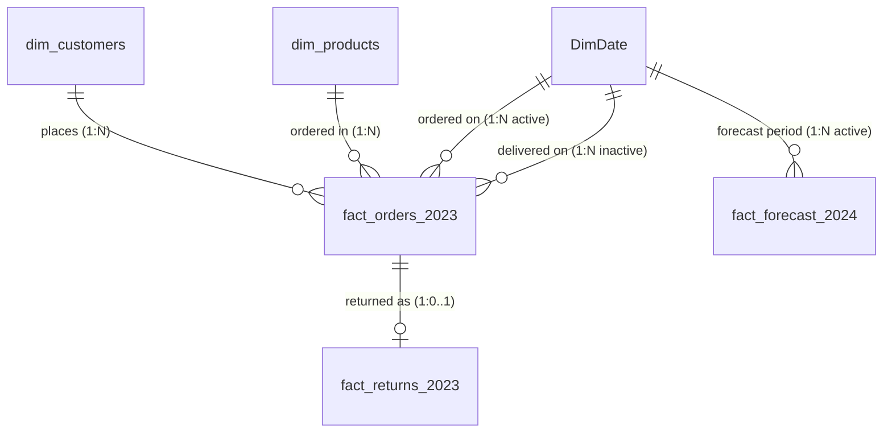

<div align="center">


# ENTERPRISE BUSINESS INTELLIGENCE & SALES ANALYTICS
### 9 Dashboard Designs | Relational Retail Dataset | DAX | Power BI | Business Insights

[](https://powerbi.microsoft.com/)
[](dax/)
[](data/)
[](docs/validation-report.md)
[](LICENSE)
[](https://dattasable.com)

**Author:** [Datta Sable](https://dattasable.com) &nbsp;|&nbsp; **Portfolio:** [dattasable.com](https://dattasable.com) &nbsp;|&nbsp; **Contact:** [info@dattasable.com](mailto:info@dattasable.com) &nbsp;|&nbsp; **LinkedIn:** [linkedin.com/in/dattasable](https://linkedin.com)

</div>

---

## 📌 Executive Summary

The **Enterprise Power BI Analytics Portfolio** is an open, production-grade business intelligence reference project showcasing modern multi-page dashboard architecture, star-schema data modeling, robust DAX engineering, and automated data quality validation.

Built on an end-to-end relational retail dataset of **231,130 records across 5 tables**, this project demonstrates how to structure, model, and deliver enterprise-ready Power BI reporting calibrated to Microsoft Fabric design standards.

> [!NOTE]
> **Authenticity & Transparency Guarantee:** Dashboard images provided in this repository are **high-fidelity visual design references and architecture blueprints**. All underlying data is synthetic demonstration data calibrated for 100% mathematical reconciliation. No pre-compiled binary report is claimed until verified; full instructions and DAX measures are provided to reproduce the reports from scratch.

---

## 🚀 Coming from LinkedIn? Start Here.

Welcome! If you discovered this project via LinkedIn, here is everything you need in one place:

- 📊 **Explore Dashboard Designs:** View the [9-Page Visual Gallery](#-9-page-dashboard-gallery) below, with each page linking to its visual build matrix.
- 💾 **Download the Clean Data:** Access the [5 relational CSV files in `data/raw/`](data/raw/) or download the ready-to-import [ZIP Release Pack](https://github.com/dattasable/enterprise-powerbi-analytics-dashboard/releases).
- 📐 **Copy Verified DAX Measures:** Browse [66 ready-to-copy DAX formulas](dax/) with business definitions and formatting rules.
- 📘 **Review the Excel Handbook:** Inspect [`excel/powerbi-implementation-handbook.xlsx`](excel/powerbi-implementation-handbook.xlsx) containing the data dictionary, relationships, and visual build matrices.
- 🎨 **Grab Vector SVG Icons:** Download [62 custom SVG icons](assets/icons/) for navigation buttons and KPI cards.
- 🛠️ **Build Your Own Report:** Follow the [24-Step Reproducible Build Guide](docs/getting-started.md).

### 📋 LinkedIn Copy-and-Share Summary
```text
Excited to share the Enterprise Power BI Analytics Portfolio by Datta Sable! 🚀
Features 9 multi-page dashboard designs, a 231,130-row relational retail dataset ($12.84M sales), 66 DAX measures, star-schema modeling, and a 62-piece SVG icon library. Fully reproducible and open-source!

Check it out: https://github.com/dattasable/enterprise-powerbi-analytics-dashboard
Portfolio: https://dattasable.com
```

**Call to Action:** *Explore the dashboards, download the sample data, and build your own enterprise Power BI report!*

---

## 📊 Validated Core Performance Metrics

All metrics reconcile to the penny across orders, customers, products, returns, and projections:

<div align="center">

| Total Gross Revenue | Total Operating Profit | Profit Margin % | Total Placed Orders | Unique Customers | Average Order Value | Return Rate % |
|:---:|:---:|:---:|:---:|:---:|:---:|:---:|
| **$12.84M** | **$2.31M** | **18.0%** | **178,200** | **46,798** | **$72.06** | **3.25%** |
| `$12,840,570.00` | `$2,310,910.00` | `17.997%` | `178,200 orders` | `46,798 accounts` | `$12.84M / 178.2K` | `5,800 / 178,200` |

</div>

- **Mathematical Reconciliation Check:** `Sales ($12,840,570.00) - Cost ($10,529,660.00) = Profit ($2,310,910.00)` ($0.00 difference).
- **Referential Integrity Check:** `0` orphan customers, `0` orphan products, `0` orphan returns.
- **Automated Validation:** Verified via continuous automated CI pipeline (`scripts/validate_data.py`).

---

## 🌟 Featured Dashboard Preview

<div align="center">

[](docs/dashboard-pages/01-executive-overview.md)

*Figure 1: Executive Overview Dashboard — Consolidated C-suite KPI pulse, monthly trends, regional splits, and product performance (Synthetic demonstration data).*

</div>

---

## 🖼️ 9-Page Dashboard Gallery

Click any preview or title below to open its dedicated visual specification and build guide:

| Page | Preview Thumbnail | Focus Area & Description | Link |
|---|:---:|---|:---:|
| **01. Executive Overview** | [](docs/dashboard-pages/01-executive-overview.md) | High-level commercial pulse, revenue ($12.84M), profit ($2.31M), regional share, and category mix. | [Read Guide →](docs/dashboard-pages/01-executive-overview.md) |
| **02. Sales Performance** | [](docs/dashboard-pages/02-sales-performance.md) | Omnichannel revenue velocity, sales channels (Online, Retail, Marketplace), monthly trends, and AOV. | [Read Guide →](docs/dashboard-pages/02-sales-performance.md) |
| **03. Product Analysis** | [](docs/dashboard-pages/03-product-analysis.md) | 320 SKU catalog evaluation, category volume, brand rankings, and price sensitivity tiers. | [Read Guide →](docs/dashboard-pages/03-product-analysis.md) |
| **04. Customer Insights** | [](docs/dashboard-pages/04-customer-insights.md) | 46,798 customers, 74.4% repeat purchase rate, acquisition channels, and demographic breakdown. | [Read Guide →](docs/dashboard-pages/04-customer-insights.md) |
| **05. Region Analysis** | [](docs/dashboard-pages/05-region-analysis.md) | Global geography across 6 regions: North America ($4.85M), Europe ($3.11M), Asia ($2.62M). | [Read Guide →](docs/dashboard-pages/05-region-analysis.md) |
| **06. Order Details** | [](docs/dashboard-pages/06-order-details.md) | Operational fulfillment pipeline: 91.1% delivered, 84.9% on-time delivery, 2.95 days average lead time. | [Read Guide →](docs/dashboard-pages/06-order-details.md) |
| **07. Profitability Analysis** | [](docs/dashboard-pages/07-profitability-analysis.md) | Financial performance, 18.0% margin distribution, COGS cost ratios, and category profitability. | [Read Guide →](docs/dashboard-pages/07-profitability-analysis.md) |
| **08. Return Analysis** | [](docs/dashboard-pages/08-return-analysis.md) | Post-purchase QA: 5,800 returns (3.25% return rate), $213.7K refunds, reason codes, and resolution mix. | [Read Guide →](docs/dashboard-pages/08-return-analysis.md) |
| **09. Forecast Analysis** | [](docs/dashboard-pages/09-forecast-analysis.md) | 2024 projections: $14.84M baseline revenue (+15.6%), 95% confidence bands, and holiday surge. | [Read Guide →](docs/dashboard-pages/09-forecast-analysis.md) |

---

## 🗂️ Relational Data Model (Star Schema)

The reporting layer operates on an optimized star schema separating numerical fact events from descriptive dimensions:



- **Grain:** One row per sales order line item in `fact_orders_2023` (178,200 rows = 178,200 orders).
- **Date Role-Playing:** Active relationship on `Order_Date`; secondary inactive relationship on `Delivery_Date` activated via `USERELATIONSHIP`.
- **Read More:** Detailed documentation in [`docs/data-model.md`](docs/data-model.md) and [`docs/relationships.md`](docs/relationships.md).

---

## 📐 DAX Measure Library Highlights

The repository includes **66 pre-calculated, verified DAX measures** organized into modular `.dax` files:

```dax
// Core Gross Revenue
Total Sales = SUM ( fact_orders_2023[Sales_Amount_USD] )

// Operating Profit & Margin
Total Profit = SUM ( fact_orders_2023[Profit_Amount_USD] )
Profit Margin = DIVIDE ( [Total Profit], [Total Sales], 0 )

// Repeat Customer Loyalty Rate
Repeat Customer Rate = 
VAR MultiBuyers = 
    COUNTROWS (
        FILTER (
            dim_customers,
            CALCULATE ( DISTINCTCOUNT ( fact_orders_2023[Order_ID] ) ) > 1
        )
    )
RETURN
    DIVIDE ( MultiBuyers, [Total Customers], 0 )

// Return Rate %
Return Rate = DIVIDE ( [Returned Orders], [Total Orders], 0 )
```

👉 Explore all 66 measures in the [DAX Measure Directory](dax/).

---

## 📂 Repository File Structure

```text
enterprise-powerbi-analytics-dashboard/
│
├── README.md                                <- Project landing page & documentation index
├── LICENSE                                  <- Dual MIT (Code) & CC-BY-4.0 (Data/Designs)
├── CHANGELOG.md                             <- Version history & milestone logs
├── CONTRIBUTING.md                          <- Contribution guidelines
├── CODE_OF_CONDUCT.md                       <- Contributor Covenant standard
├── SECURITY.md                              <- Security disclosure policy
├── .gitignore / .gitattributes              <- Git repository configuration
│
├── assets/
│   ├── branding/                            <- Datta Sable official monograms & logos
│   ├── dashboards/                          <- 9 high-res dashboard designs (PNG & WebP)
│   └── icons/                               <- 62 categorized SVG vector icons
│
├── data/
│   ├── raw/                                 <- Full source CSV files (231,130 records)
│   ├── samples/                             <- 100-row preview samples
│   ├── README.md                            <- Dataset inventory & provenance
│   └── data-dictionary.md                   <- Complete 49-column schema specification
│
├── dax/
│   ├── measures/                            <- 9 domain-specific DAX measure files
│   ├── calculated-columns.dax               <- Recommended dimensional calculated columns
│   ├── date-table.dax                       <- Calendar table generation script
│   └── README.md                            <- DAX implementation instructions
│
├── docs/
│   ├── getting-started.md                   <- 24-step end-to-end build guide
│   ├── architecture.md                      <- Enterprise BI & Fabric architecture
│   ├── data-model.md                        <- Star schema specification & Mermaid ERD
│   ├── relationships.md                     <- Relationship cardinalities & filter propagation
│   ├── kpi-definitions.md                   <- Calculation logic & benchmark targets
│   ├── power-query-guide.md                 <- Power Query ETL steps & M-code
│   ├── dax-guide.md                         <- DAX optimization & filter context
│   ├── slicers-interactions.md              <- Slicer synchronization matrix
│   ├── visual-style-guide.md                <- Fabric light theme design tokens
│   ├── forecasting-methodology.md           <- 2024 scenario projections
│   ├── assumptions-limitations.md           <- Transparent modeling boundaries
│   ├── validation-report.md                 <- Automated validation audit evidence
│   └── dashboard-pages/                     <- 9 visual-by-visual build guides
│
├── excel/
│   └── powerbi-implementation-handbook.xlsx <- Master 11-sheet implementation workbook
│
├── scripts/
│   ├── requirements.txt                     <- Python testing dependencies
│   ├── validate_data.py                     <- Automated schema & financial reconciliation
│   ├── validate_assets.py                   <- Automated image & SVG syntax validation
│   ├── generate_validation_report.py        <- Markdown audit report generator
│   └── package_release.py                   <- Zip package release builder
│
├── tests/                                   <- Automated Python test suite (24 unit tests)
│   ├── test_relationships.py
│   ├── test_financial_metrics.py
│   ├── test_returns.py
│   └── test_data_quality.py
│
├── reports/
│   └── README.md                            <- Report development guide & roadmap
│
└── .github/
    ├── workflows/validate.yml               <- GitHub Actions continuous integration CI
    └── ISSUE_TEMPLATE/                      <- Bug reports & feature request templates
```

---

## 🛠️ Automated Testing & Validation Engine

To execute the automated validation engine and test suite locally:

```bash
# 1. Install dependencies
pip install -r scripts/requirements.txt

# 2. Run schema and financial reconciliation audit
python scripts/validate_data.py

# 3. Run image and SVG asset validation
python scripts/validate_assets.py

# 4. Run full unit test suite (24 tests)
python -m unittest discover tests

# 5. Generate fresh validation report
python scripts/generate_validation_report.py
```

All 24 automated unit tests execute in under 4 seconds, verifying schema integrity, referential keys, financial formulas, and date ranges.

---

## 📦 Downloadable Resource Packs (Release v1.0.0)

Pre-packaged ZIP archives are available under [Releases](https://github.com/dattasable/enterprise-powerbi-analytics-dashboard/releases):
- 📁 **Complete Datasets Pack:** All 5 relational CSV files + Data Dictionary.
- 🎨 **SVG Vector Icon Pack:** 62 clean SVG icons categorized by navigation, KPIs, and charts.
- 🖼️ **Dashboard Design Pack:** All 9 high-resolution dashboard mockups in lossless PNG and WebP.
- 📊 **DAX & Implementation Handbook:** Excel handbook (`.xlsx`) + complete DAX measure files.

---

## ⚖️ License & Attribution

- **Scripts & Code:** [MIT License](LICENSE) (c) 2024 Datta Sable.
- **Documentation, Datasets & Design Assets:** [Creative Commons Attribution 4.0 International (CC BY 4.0)](LICENSE).
- **Microsoft Trademark Disclaimer:** This project is an independent educational and portfolio resource. It is not affiliated with, endorsed by, or sponsored by Microsoft Corporation. *Microsoft Power BI*, *Microsoft Fabric*, *Power Query*, and *DAX* are trademarks of Microsoft Corporation.

---

## 📬 Author & Professional Contact

**Datta Sable**  
Senior Business Intelligence Architect & Analytics Specialist  
- 🌐 **Portfolio Website:** [dattasable.com](https://dattasable.com)  
- 💼 **LinkedIn Profile:** [linkedin.com/in/dattasable](https://linkedin.com)  
- ✉️ **Direct Email:** [info@dattasable.com](mailto:info@dattasable.com)
