# Enterprise Business Intelligence Architecture

This document describes the end-to-end technical architecture of the **Enterprise Power BI Analytics Portfolio**, covering the conceptual ingestion pipeline, tabular semantic layer, analytical DAX model, and Microsoft Fabric migration path.

---

## Architecture Diagram

```mermaid
graph TD
    subgraph Data_Sources ["1. Source Data Layer"]
        CSV_Orders["fact_orders_2023.csv<br/>(178,200 rows)"]
        CSV_Customers["dim_customers.csv<br/>(46,798 rows)"]
        CSV_Products["dim_products.csv<br/>(320 rows)"]
        CSV_Returns["fact_returns_2023.csv<br/>(5,800 rows)"]
        CSV_Forecast["fact_forecast_2024.csv<br/>(12 rows)"]
    end

    subgraph ETL_Layer ["2. Power Query ETL Engine"]
        PQ_Clean["Data Cleansing & Trim"]
        PQ_Types["Type Coercion (Currency, Date, Text)"]
        PQ_Validate["Referential Integrity & Null Checks"]
    end

    subgraph Semantic_Model ["3. Tabular Semantic Model (VertiPaq)"]
        StarSchema["Star Schema Model<br/>1 Fact + 3 Dimensions + 2 Supporting Facts"]
        CalendarDim["DimDate (DAX Generated Calendar)<br/>2023-01-01 to 2024-12-31"]
    end

    subgraph Analytical_Engine ["4. DAX Calculation Engine"]
        CoreMeasures["Core KPIs ($12.84M Sales, $2.31M Profit)"]
        TimeIntel["Time Intelligence (YTD, MTD, Rolling 3M)"]
        SegmentMeasures["Segmentation & Ranks (Pareto, AOV, Margin)"]
    end

    subgraph Presentation_Layer ["5. Multi-Page Visual Layer"]
        P1["01 Executive Overview"]
        P2["02 Sales Performance"]
        P3["03 Product Analysis"]
        P4["04 Customer Insights"]
        P5["05 Region Analysis"]
        P6["06 Order Details"]
        P7["07 Profitability Analysis"]
        P8["08 Return Analysis"]
        P9["09 Forecast Analysis"]
    end

    Data_Sources --> ETL_Layer
    ETL_Layer --> Semantic_Model
    Semantic_Model --> Analytical_Engine
    Analytical_Engine --> Presentation_Layer
```

---

## Architectural Principles

### 1. Separation of Fact and Dimension Tables
The architecture strictly enforces dimensional modeling principles:
- **Fact Tables:** Store numeric metrics, quantities, monetary values, and foreign keys.
- **Dimension Tables:** Store descriptive textual attributes and hierarchies (Customer segment, product brand, category).
- **No Snowflaking:** Kept flat to minimize join overhead and optimize VertiPaq column-store dictionary compression.

### 2. High-Performance In-Memory VertiPaq Engine
- Fixed Decimal types are used for currencies (4 decimal places stored as 64-bit integers), maximizing run-length and bit-packing compression.
- IDs and codes are isolated as Text keys, ensuring VertiPaq builds compact hash dictionaries.

### 3. Microsoft Fabric Readiness
The project structure is engineered to seamlessly migrate to Microsoft Fabric:
- **OneLake Lakehouse:** Raw CSVs can be uploaded directly to `Files/` or loaded into Delta Lake tables via PySpark.
- **Direct Lake Mode:** The star schema allows Direct Lake semantic modeling without data duplication or import refresh overhead.
- **Fabric Notebooks:** Python validation scripts (`scripts/validate_data.py`) can run as automated Fabric Data Factory pipeline tasks.
