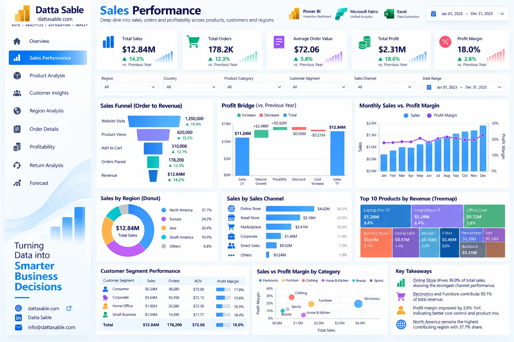

# Sales Performance Analytics Dashboard — Development & Implementation Guide

This document provides the complete technical and visual specification for **Page 02: Sales Performance Analytics Dashboard** of the **Enterprise Power BI Analytics Portfolio**.

---

## 1. Business Objective
Deliver granular transactional sales visibility across omnichannel sales touchpoints, seasonal revenue trends, product treemaps, and sales channel performance.

---

## 2. Executive Questions Answered
- Which sales channels generate the highest revenue and transaction volume?
- How does sales revenue fluctuate by month, quarter, and day of week?
- What is the distribution of order basket values across standard and express orders?
- How do individual product subcategories contribute to overall sales volume?
- What is our month-over-month revenue velocity?

---

## 3. Dashboard Preview

*Figure 02: Sales Performance Analytics Dashboard design reference mockup (synthetic demonstration data).*

---

## 4. Key Performance Indicator (KPI) Definitions

| KPI Card | Target Value / Reconciled Benchmark | Bound DAX Measure | Business Description |
|---|---|---|---|
| **Total Sales Revenue** | `$12,840,570.00` | `[Total Sales]` | Total volume across all channels |
| **Sales YTD** | `$12,840,570.00` | `[Sales YTD]` | Year-to-date sales accumulation |
| **Average Order Value** | `$72.06` | `[Average Order Value]` | Revenue per order transaction |
| **Units Sold** | `178,200` | `[Units Sold]` | Total physical units delivered |
| **Online Store Share** | `35.87% ($4.61M)` | `[Sales Share %]` | Percentage of revenue through online storefront |

---

## 5. Visual Inventory & Build Matrix

The following visual specifications define the exact layout, chart types, data fields, and measure bindings for this report page:

| Visual Title | Power BI Visual Type | Axis / Rows / Legend | Values / Bound Measures | Interactions & Notes |
|---|---|---|---|---|

---

## 6. Required Source Tables
- [`fact_orders_2023`](../../data/data-dictionary.md#fact_orders_2023)
- [`dim_products`](../../data/data-dictionary.md#dim_products)
- [`dim_customers`](../../data/data-dictionary.md#dim_customers)
- [`DimDate`](../../data/data-dictionary.md#DimDate)

---

## 7. Field Mappings & Schema Requirements

- **Primary Date Field:** `DimDate[Date]` (or `fact_forecast_2024[Forecast_Month]` for Page 09)
- **Aggregation Dimensions:** Mapped directly from conformed dimensions (`dim_customers`, `dim_products`, `DimDate`).
- **Measures Storage:** All calculations referenced from the dedicated `_Measures` container.

---

## 8. DAX Measures Used on this Page

The following verified DAX measures from [`dax/measures/`](../../dax/measures/) drive this view:
- `[Total Sales]`
- `[Sales YTD]`
- `[Sales MoM %]`
- `[Average Order Value]`
- `[Units Sold]`
- `[Sales Share %]`

---

## 9. Filters & Slicers Configuration

- **Page Slicers:**
  - Date Range (DimDate[Date])
  - Sales Channel (fact_orders_2023[Sales_Channel])
  - Region (fact_orders_2023[Region])
  - Product Category (dim_products[Product_Category])

---

## 10. Visual Interactions & Cross-Filtering Behavior

- **Edit Interactions:** All visuals set to **Filter** mode when interacting with bar charts and category tiles.
- **Cross-Highlighting:** Disabled on line charts to prevent low-contrast background bars.
- **Synchronized Slicers:** Date range and global regional slicers synchronize with other historical report pages.

---

## 11. Expected Analytical Insights
- Online Store ($4.61M, 64.1K orders) and Retail Stores ($3.19M, 44.2K orders) represent over 60% of commercial revenue.
- Marketplace channels provide high transaction frequency with slightly lower average order values ($72.19).
- Corporate sales channels drive the highest basket sizes, averaging over $71.60 per transaction with lower order frequency.

---

## 12. Validation Requirements

- Verify all card values match the benchmark targets listed in Section 4.
- Sum of category / regional slices must reconcile exactly to the top-level total without duplication.
- Ensure automated test suite (`tests/`) passes before publishing.

---

## 13. Step-by-Step Implementation Instructions

1. **Create Page Canvas:** Add a new page in Power BI Desktop and name it `Sales Performance Analytics Dashboard`.
2. **Apply Visual Grid:** Configure a 16:9 canvas with `#F5F8FC` background and 16px page margins.
3. **Add Navigation Header:** Place the Datta Sable monogram logo and top navigation bar.
4. **Insert KPI Cards:** Place the top summary cards using Segoe UI 28pt bold callout values.
5. **Construct Charts:** Follow the Visual Inventory table in Section 5 to create and position each chart.
6. **Configure Interactions:** Select each visual, navigate to **Format > Edit Interactions**, and enforce single-direction filtering.
7. **Test Slicers:** Select various dates and segments to confirm responsive recalculation.

---

## 14. Known Limitations & Authenticity Notes

- Channel metrics reflect order line attributes recorded at time of sale; customer omnichannel switching is not modeled.
- Visual mockup depicted in Section 3 serves as an illustrative design benchmark; underlying dataset metrics are the authoritative source of truth.
