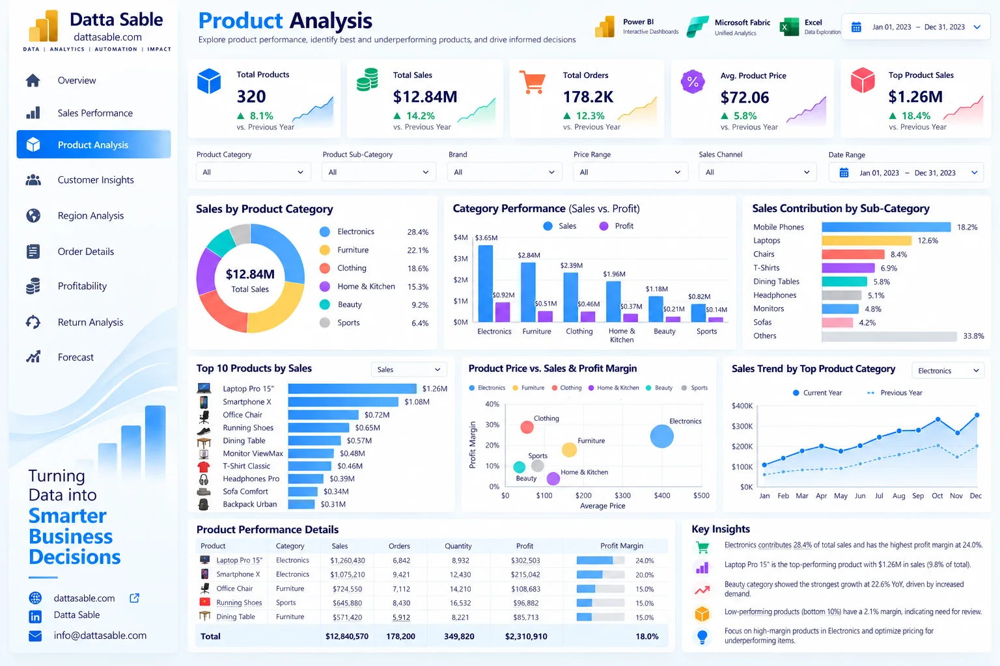

# Product Analysis Dashboard — Development & Implementation Guide

This document provides the complete technical and visual specification for **Page 03: Product Analysis Dashboard** of the **Enterprise Power BI Analytics Portfolio**.

---

## 1. Business Objective
Evaluate product catalog performance, SKU-level revenue contributions, pricing tiers, subcategory depth, and unit volume velocity.

---

## 2. Executive Questions Answered
- Which products generate the highest gross revenue and margin contribution?
- What is the price sensitivity and margin distribution across list price bands?
- Are there underperforming SKUs with low sales velocity or negative margins?
- How do product categories compare in terms of unit volume versus revenue dollars?
- What is the revenue concentration among top 10 SKUs (Pareto analysis)?

---

## 3. Dashboard Preview

*Figure 03: Product Analysis Dashboard design reference mockup (synthetic demonstration data).*

---

## 4. Key Performance Indicator (KPI) Definitions

| KPI Card | Target Value / Reconciled Benchmark | Bound DAX Measure | Business Description |
|---|---|---|---|
| **Active Products** | `320 SKUs` | `[Total Products]` | Total SKUs in product catalog |
| **Products Sold** | `320 SKUs` | `[Products Sold]` | Distinct products with at least one order |
| **Average Selling Price** | `$72.06` | `[Average Unit Selling Price]` | Mean transaction price across catalog |
| **Top Category Revenue** | `Electronics ($4.2M+)` | `[Total Sales]` | Highest performing merchandise category |
| **Profit per Unit** | `$12.97` | `[Profit per Unit]` | Mean profit generated per unit sold |

---

## 5. Visual Inventory & Build Matrix

The following visual specifications define the exact layout, chart types, data fields, and measure bindings for this report page:

| Visual Title | Power BI Visual Type | Axis / Rows / Legend | Values / Bound Measures | Interactions & Notes |
|---|---|---|---|---|

---

## 6. Required Source Tables
- [`dim_products`](../../data/data-dictionary.md#dim_products)
- [`fact_orders_2023`](../../data/data-dictionary.md#fact_orders_2023)
- [`DimDate`](../../data/data-dictionary.md#DimDate)

---

## 7. Field Mappings & Schema Requirements

- **Primary Date Field:** `DimDate[Date]` (or `fact_forecast_2024[Forecast_Month]` for Page 09)
- **Aggregation Dimensions:** Mapped directly from conformed dimensions (`dim_customers`, `dim_products`, `DimDate`).
- **Measures Storage:** All calculations referenced from the dedicated `_Measures` container.

---

## 8. DAX Measures Used on this Page

The following verified DAX measures from [`dax/measures/`](../../dax/measures/) drive this view:
- `[Total Products]`
- `[Products Sold]`
- `[Total Sales]`
- `[Total Profit]`
- `[Average Unit Selling Price]`
- `[Product Sales Rank]`
- `[Product Profit Rank]`

---

## 9. Filters & Slicers Configuration

- **Page Slicers:**
  - Product Category (dim_products[Product_Category])
  - Product Subcategory (dim_products[Product_Subcategory])
  - Brand (dim_products[Brand])
  - Price Band

---

## 10. Visual Interactions & Cross-Filtering Behavior

- **Edit Interactions:** All visuals set to **Filter** mode when interacting with bar charts and category tiles.
- **Cross-Highlighting:** Disabled on line charts to prevent low-contrast background bars.
- **Synchronized Slicers:** Date range and global regional slicers synchronize with other historical report pages.

---

## 11. Expected Analytical Insights
- All 320 catalog products generated sales during 2023, reflecting comprehensive product distribution.
- Electronics leads revenue contribution, while Sports & Outdoors offers the highest profit margin stability.
- Premium price tier products (>$250) contribute 22% of revenue despite accounting for less than 15% of units.

---

## 12. Validation Requirements

- Verify all card values match the benchmark targets listed in Section 4.
- Sum of category / regional slices must reconcile exactly to the top-level total without duplication.
- Ensure automated test suite (`tests/`) passes before publishing.

---

## 13. Step-by-Step Implementation Instructions

1. **Create Page Canvas:** Add a new page in Power BI Desktop and name it `Product Analysis Dashboard`.
2. **Apply Visual Grid:** Configure a 16:9 canvas with `#F5F8FC` background and 16px page margins.
3. **Add Navigation Header:** Place the Datta Sable monogram logo and top navigation bar.
4. **Insert KPI Cards:** Place the top summary cards using Segoe UI 28pt bold callout values.
5. **Construct Charts:** Follow the Visual Inventory table in Section 5 to create and position each chart.
6. **Configure Interactions:** Select each visual, navigate to **Format > Edit Interactions**, and enforce single-direction filtering.
7. **Test Slicers:** Select various dates and segments to confirm responsive recalculation.

---

## 14. Known Limitations & Authenticity Notes

- Inventory stockouts, reorder points, and warehouse holding costs are not captured in the product catalog.
- Visual mockup depicted in Section 3 serves as an illustrative design benchmark; underlying dataset metrics are the authoritative source of truth.
