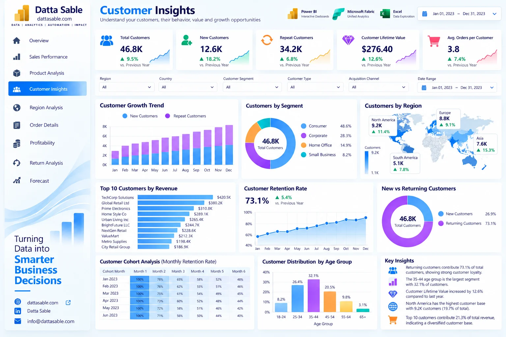

# Customer Insights Analytics Dashboard — Development & Implementation Guide

This document provides the complete technical and visual specification for **Page 04: Customer Insights Analytics Dashboard** of the **Enterprise Power BI Analytics Portfolio**.

---

## 1. Business Objective
Analyze customer acquisition channels, buying behavior, customer lifetime spending, repeat purchase propensity, and demographic segments.

---

## 2. Executive Questions Answered
- How many unique customers made purchases in 2023?
- What percentage of our customer base are repeat buyers versus one-time purchasers?
- Which acquisition channels (Organic, Paid, Email, Social) generate the highest customer value?
- How is revenue distributed across age brackets and demographic groups?
- What is the average revenue and order count per customer?

---

## 3. Dashboard Preview

*Figure 04: Customer Insights Analytics Dashboard design reference mockup (synthetic demonstration data).*

---

## 4. Key Performance Indicator (KPI) Definitions

| KPI Card | Target Value / Reconciled Benchmark | Bound DAX Measure | Business Description |
|---|---|---|---|
| **Total Customers** | `46,798` | `[Total Customers]` | Unique purchasing accounts in 2023 |
| **Repeat Customer Rate** | `74.4%` | `[Repeat Customer Rate]` | Customers with 2 or more lifetime orders |
| **Repeat Customers** | `34,818` | `[Repeat Customer Count]` | Count of multi-order accounts |
| **Revenue per Customer** | `$274.38` | `[Revenue per Customer]` | Mean gross spend per registered customer |
| **Orders per Customer** | `3.81 orders` | `[Orders per Customer]` | Mean transaction frequency per account |

---

## 5. Visual Inventory & Build Matrix

The following visual specifications define the exact layout, chart types, data fields, and measure bindings for this report page:

| Visual Title | Power BI Visual Type | Axis / Rows / Legend | Values / Bound Measures | Interactions & Notes |
|---|---|---|---|---|

---

## 6. Required Source Tables
- [`dim_customers`](../../data/data-dictionary.md#dim_customers)
- [`fact_orders_2023`](../../data/data-dictionary.md#fact_orders_2023)
- [`DimDate`](../../data/data-dictionary.md#DimDate)

---

## 7. Field Mappings & Schema Requirements

- **Primary Date Field:** `DimDate[Date]` (or `fact_forecast_2024[Forecast_Month]` for Page 09)
- **Aggregation Dimensions:** Mapped directly from conformed dimensions (`dim_customers`, `dim_products`, `DimDate`).
- **Measures Storage:** All calculations referenced from the dedicated `_Measures` container.

---

## 8. DAX Measures Used on this Page

The following verified DAX measures from [`dax/measures/`](../../dax/measures/) drive this view:
- `[Total Customers]`
- `[Repeat Customer Rate]`
- `[Repeat Customer Count]`
- `[Revenue per Customer]`
- `[Orders per Customer]`
- `[Customer Share %]`

---

## 9. Filters & Slicers Configuration

- **Page Slicers:**
  - Customer Segment (dim_customers[Customer_Segment])
  - Age Group (dim_customers[Age_Group])
  - Acquisition Channel (dim_customers[Acquisition_Channel])
  - Date Range

---

## 10. Visual Interactions & Cross-Filtering Behavior

- **Edit Interactions:** All visuals set to **Filter** mode when interacting with bar charts and category tiles.
- **Cross-Highlighting:** Disabled on line charts to prevent low-contrast background bars.
- **Synchronized Slicers:** Date range and global regional slicers synchronize with other historical report pages.

---

## 11. Expected Analytical Insights
- Strong repeat customer rate of 74.4% indicates high customer loyalty and successful post-purchase retention.
- Organic Search and Email acquisition channels yield the highest average customer spend ($280+).
- The 25–45 age demographic generates over 58% of commercial sales volume.

---

## 12. Validation Requirements

- Verify all card values match the benchmark targets listed in Section 4.
- Sum of category / regional slices must reconcile exactly to the top-level total without duplication.
- Ensure automated test suite (`tests/`) passes before publishing.

---

## 13. Step-by-Step Implementation Instructions

1. **Create Page Canvas:** Add a new page in Power BI Desktop and name it `Customer Insights Analytics Dashboard`.
2. **Apply Visual Grid:** Configure a 16:9 canvas with `#F5F8FC` background and 16px page margins.
3. **Add Navigation Header:** Place the Datta Sable monogram logo and top navigation bar.
4. **Insert KPI Cards:** Place the top summary cards using Segoe UI 28pt bold callout values.
5. **Construct Charts:** Follow the Visual Inventory table in Section 5 to create and position each chart.
6. **Configure Interactions:** Select each visual, navigate to **Format > Edit Interactions**, and enforce single-direction filtering.
7. **Test Slicers:** Select various dates and segments to confirm responsive recalculation.

---

## 14. Known Limitations & Authenticity Notes

- Data is limited to customers with order activity in 2023; inactive customer churn modeling requires multi-year tracking.
- Visual mockup depicted in Section 3 serves as an illustrative design benchmark; underlying dataset metrics are the authoritative source of truth.
