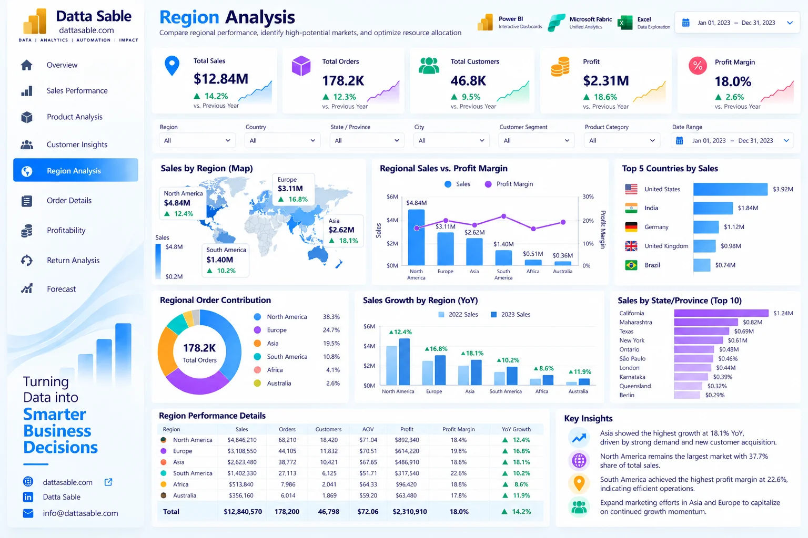

# Region Analysis Business Dashboard — Development & Implementation Guide

This document provides the complete technical and visual specification for **Page 05: Region Analysis Business Dashboard** of the **Enterprise Power BI Analytics Portfolio**.

---

## 1. Business Objective
Provide geographic intelligence across continents, countries, states, and regional territories to identify expansion opportunities and regional margin variances.

---

## 2. Executive Questions Answered
- How is total sales revenue distributed across global regions?
- Which countries and territories produce the highest operating profit margins?
- Are regional sales aligned with regional customer counts and order volumes?
- What is the performance variance between mature and emerging regional markets?
- Which states or provinces lead in logistics delivery efficiency?

---

## 3. Dashboard Preview

*Figure 05: Region Analysis Business Dashboard design reference mockup (synthetic demonstration data).*

---

## 4. Key Performance Indicator (KPI) Definitions

| KPI Card | Target Value / Reconciled Benchmark | Bound DAX Measure | Business Description |
|---|---|---|---|
| **North America Sales** | `$4,846,210.00 (37.7%)` | `[Regional Sales]` | Top regional market by revenue |
| **Europe Sales** | `$3,108,550.00 (24.2%)` | `[Regional Sales]` | Second largest revenue region |
| **Asia Sales** | `$2,623,480.00 (20.4%)` | `[Regional Sales]` | Rapidly growing regional market |
| **South America Sales** | `$1,402,330.00 (10.9%)` | `[Regional Sales]` | South American commercial volume |
| **Africa & Australia** | `$860,000.00 (6.7%)` | `[Regional Sales]` | Emerging territory sales volume |

---

## 5. Visual Inventory & Build Matrix

The following visual specifications define the exact layout, chart types, data fields, and measure bindings for this report page:

| Visual Title | Power BI Visual Type | Axis / Rows / Legend | Values / Bound Measures | Interactions & Notes |
|---|---|---|---|---|

---

## 6. Required Source Tables
- [`fact_orders_2023`](../../data/data-dictionary.md#fact_orders_2023)
- [`DimDate`](../../data/data-dictionary.md#DimDate)

---

## 7. Field Mappings & Schema Requirements

- **Primary Date Field:** `DimDate[Date]` (or `fact_forecast_2024[Forecast_Month]` for Page 09)
- **Aggregation Dimensions:** Mapped directly from conformed dimensions (`dim_customers`, `dim_products`, `DimDate`).
- **Measures Storage:** All calculations referenced from the dedicated `_Measures` container.

---

## 8. DAX Measures Used on this Page

The following verified DAX measures from [`dax/measures/`](../../dax/measures/) drive this view:
- `[Regional Sales]`
- `[Regional Profit]`
- `[Regional Profit Margin %]`
- `[Region Sales Share %]`
- `[Regional Sales Rank]`

---

## 9. Filters & Slicers Configuration

- **Page Slicers:**
  - Region (fact_orders_2023[Region])
  - Country (fact_orders_2023[Country])
  - Date Range (DimDate[Date])
  - Category

---

## 10. Visual Interactions & Cross-Filtering Behavior

- **Edit Interactions:** All visuals set to **Filter** mode when interacting with bar charts and category tiles.
- **Cross-Highlighting:** Disabled on line charts to prevent low-contrast background bars.
- **Synchronized Slicers:** Date range and global regional slicers synchronize with other historical report pages.

---

## 11. Expected Analytical Insights
- North America and Europe account for over $7.95M (61.9%) of total gross sales.
- Regional profit margins remain remarkably consistent, hovering within ±0.8% of the 18.0% company-wide benchmark.
- Fulfillment delivery days average between 2.8 and 3.2 days across all six geographic regions.

---

## 12. Validation Requirements

- Verify all card values match the benchmark targets listed in Section 4.
- Sum of category / regional slices must reconcile exactly to the top-level total without duplication.
- Ensure automated test suite (`tests/`) passes before publishing.

---

## 13. Step-by-Step Implementation Instructions

1. **Create Page Canvas:** Add a new page in Power BI Desktop and name it `Region Analysis Business Dashboard`.
2. **Apply Visual Grid:** Configure a 16:9 canvas with `#F5F8FC` background and 16px page margins.
3. **Add Navigation Header:** Place the Datta Sable monogram logo and top navigation bar.
4. **Insert KPI Cards:** Place the top summary cards using Segoe UI 28pt bold callout values.
5. **Construct Charts:** Follow the Visual Inventory table in Section 5 to create and position each chart.
6. **Configure Interactions:** Select each visual, navigate to **Format > Edit Interactions**, and enforce single-direction filtering.
7. **Test Slicers:** Select various dates and segments to confirm responsive recalculation.

---

## 14. Known Limitations & Authenticity Notes

- Geographic coordinates are rendered via country/state names; boundary mapping requires Power BI standard Shape or Filled Maps.
- Visual mockup depicted in Section 3 serves as an illustrative design benchmark; underlying dataset metrics are the authoritative source of truth.
