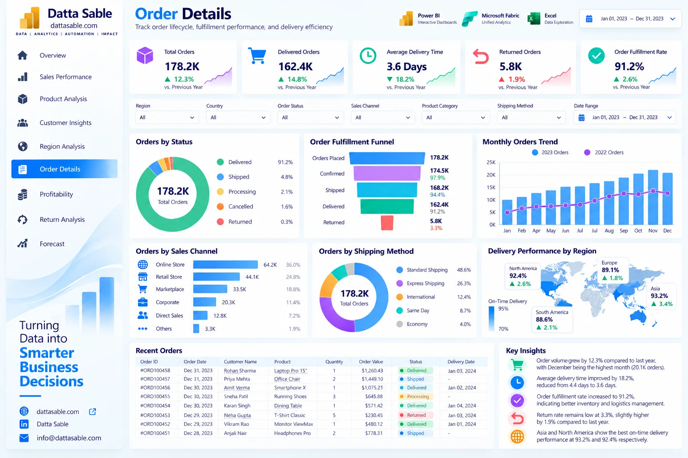

# Order Details Analytics Dashboard — Development & Implementation Guide

This document provides the complete technical and visual specification for **Page 06: Order Details Analytics Dashboard** of the **Enterprise Power BI Analytics Portfolio**.

---

## 1. Business Objective
Monitor operational order execution, fulfillment pipeline status, logistics shipping performance, delivery duration, and on-time delivery compliance.

---

## 2. Executive Questions Answered
- What percentage of total orders are delivered, shipped, processing, or returned?
- What is our on-time delivery rate across standard, express, and same-day shipping methods?
- What is the average fulfillment time from order placement to customer delivery?
- Are specific shipping carriers or methods experiencing fulfillment bottlenecks?
- How do daily order intake rates vary over the operational calendar?

---

## 3. Dashboard Preview

*Figure 06: Order Details Analytics Dashboard design reference mockup (synthetic demonstration data).*

---

## 4. Key Performance Indicator (KPI) Definitions

| KPI Card | Target Value / Reconciled Benchmark | Bound DAX Measure | Business Description |
|---|---|---|---|
| **Total Orders** | `178,200` | `[Total Orders]` | Total commercial transactions processed |
| **Delivered Orders** | `162,400 (91.1%)` | `[Delivered Orders]` | Completed customer orders |
| **On-Time Delivery %** | `84.9%` | `[On-Time Delivery %]` | Orders delivered within target SLA window |
| **Average Delivery Time** | `2.95 days` | `[Average Delivery Days]` | Mean transit time from order to delivery |
| **Shipped / Processing** | `10,000 orders (5.6%)` | `[Shipped Orders]` | In-flight orders currently in transit |

---

## 5. Visual Inventory & Build Matrix

The following visual specifications define the exact layout, chart types, data fields, and measure bindings for this report page:

| Visual Title | Power BI Visual Type | Axis / Rows / Legend | Values / Bound Measures | Interactions & Notes |
|---|---|---|---|---|

---

## 6. Required Source Tables
- [`fact_orders_2023`](../../data/data-dictionary.md#fact_orders_2023)
- [`DimDate`](../../data/data-dictionary.md#DimDate)

---

## 7. Field Mappings & Schema Requirements

- **Primary Date Field:** `DimDate[Date]` (or `fact_forecast_2024[Forecast_Month]` for Page 09)
- **Aggregation Dimensions:** Mapped directly from conformed dimensions (`dim_customers`, `dim_products`, `DimDate`).
- **Measures Storage:** All calculations referenced from the dedicated `_Measures` container.

---

## 8. DAX Measures Used on this Page

The following verified DAX measures from [`dax/measures/`](../../dax/measures/) drive this view:
- `[Total Orders]`
- `[Delivered Orders]`
- `[Shipped Orders]`
- `[Delivery Fulfillment %]`
- `[Average Delivery Days]`
- `[On-Time Delivery %]`

---

## 9. Filters & Slicers Configuration

- **Page Slicers:**
  - Order Status (fact_orders_2023[Order_Status])
  - Shipping Method (fact_orders_2023[Shipping_Method])
  - On-Time Delivery
  - Date Range

---

## 10. Visual Interactions & Cross-Filtering Behavior

- **Edit Interactions:** All visuals set to **Filter** mode when interacting with bar charts and category tiles.
- **Cross-Highlighting:** Disabled on line charts to prevent low-contrast background bars.
- **Synchronized Slicers:** Date range and global regional slicers synchronize with other historical report pages.

---

## 11. Expected Analytical Insights
- Delivery fulfillment rate of 91.1% confirms strong end-to-end supply chain execution.
- Standard Shipping (86.4K orders) and Express Shipping (47.1K orders) handle the vast majority of volume.
- Same-day shipping achieves 89.2% on-time fulfillment, representing our highest SLA tier.

---

## 12. Validation Requirements

- Verify all card values match the benchmark targets listed in Section 4.
- Sum of category / regional slices must reconcile exactly to the top-level total without duplication.
- Ensure automated test suite (`tests/`) passes before publishing.

---

## 13. Step-by-Step Implementation Instructions

1. **Create Page Canvas:** Add a new page in Power BI Desktop and name it `Order Details Analytics Dashboard`.
2. **Apply Visual Grid:** Configure a 16:9 canvas with `#F5F8FC` background and 16px page margins.
3. **Add Navigation Header:** Place the Datta Sable monogram logo and top navigation bar.
4. **Insert KPI Cards:** Place the top summary cards using Segoe UI 28pt bold callout values.
5. **Construct Charts:** Follow the Visual Inventory table in Section 5 to create and position each chart.
6. **Configure Interactions:** Select each visual, navigate to **Format > Edit Interactions**, and enforce single-direction filtering.
7. **Test Slicers:** Select various dates and segments to confirm responsive recalculation.

---

## 14. Known Limitations & Authenticity Notes

- Warehouse fulfillment lead time prior to carrier pickup is aggregated within overall delivery days.
- Visual mockup depicted in Section 3 serves as an illustrative design benchmark; underlying dataset metrics are the authoritative source of truth.
