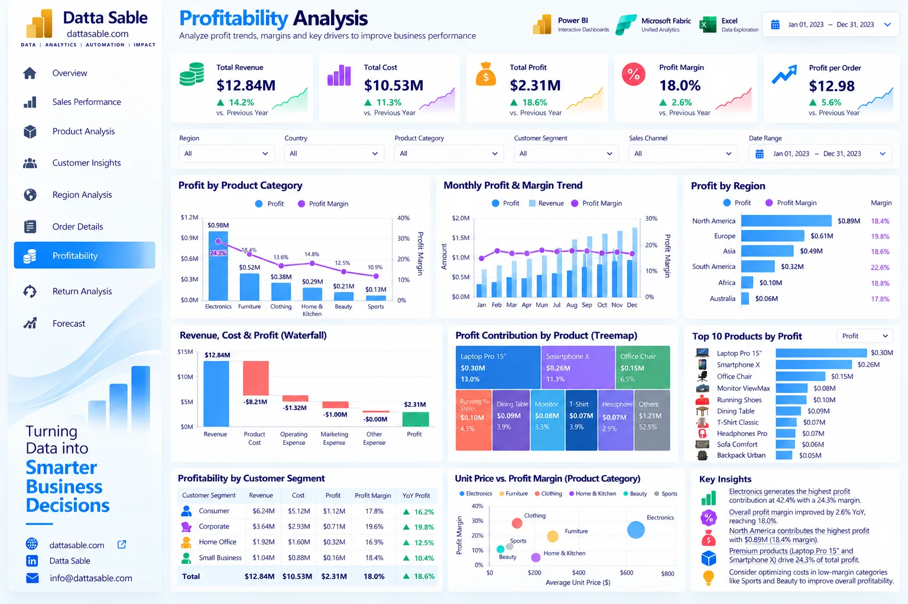

# Profitability Analysis Dashboard — Development & Implementation Guide

This document provides the complete technical and visual specification for **Page 07: Profitability Analysis Dashboard** of the **Enterprise Power BI Analytics Portfolio**.

---

## 1. Business Objective
Provide financial analysis of operating margins, cost-of-goods-sold (COGS) ratios, category profit drivers, and revenue-to-profit waterfalls.

---

## 2. Executive Questions Answered
- What is our gross operating profit and profit margin percentage?
- How do merchandise costs break down relative to sales revenue?
- Which product categories generate the highest total operating profit dollars?
- How does operating margin fluctuate month-by-month across 2023?
- Are there negative-margin products or loss leaders in the catalog?

---

## 3. Dashboard Preview

*Figure 07: Profitability Analysis Dashboard design reference mockup (synthetic demonstration data).*

---

## 4. Key Performance Indicator (KPI) Definitions

| KPI Card | Target Value / Reconciled Benchmark | Bound DAX Measure | Business Description |
|---|---|---|---|
| **Total Profit** | `$2,310,910.00 ($2.31M)` | `[Total Profit]` | Gross sales minus direct product cost |
| **Profit Margin %** | `17.997% (~18.0%)` | `[Profit Margin]` | Operating profit divided by gross sales |
| **Total COGS** | `$10,529,660.00 ($10.53M)` | `[Total Cost]` | Direct merchandise cost of fulfilled orders |
| **Cost Ratio %** | `82.003%` | `[Cost Ratio %]` | Proportion of sales consumed by merchandise costs |
| **Cumulative Profit YTD** | `$2,310,910.00` | `[Cumulative Profit YTD]` | Year-to-date accumulated profit |

---

## 5. Visual Inventory & Build Matrix

The following visual specifications define the exact layout, chart types, data fields, and measure bindings for this report page:

| Visual Title | Power BI Visual Type | Axis / Rows / Legend | Values / Bound Measures | Interactions & Notes |
|---|---|---|---|---|
| **Category profit vs margin** | Combo | `dim_products[Product_Category]` | `[Total Profit], [Profit Margin]` | Weighted margin |
| **Monthly margin** | Combo | `DimDate[Year Month]` | `[Total Sales], [Total Profit], [Profit Margin]` | Separate axes |
| **Profit by region** | Bar | `fact_orders_2023[Region]` | `[Total Profit], [Profit Margin]` | Rank by profit |
| **Revenue-cost-profit bridge** | Waterfall | `Revenue / Cost / Profit` | `[Total Sales], [Total Cost], [Total Profit]` | Build disconnected steps table; cost negative |
| **Product profit treemap** | Treemap | `dim_products[Product_Name]` | `[Total Profit]` | Negative profit products need alternate view |
| **Top profit products** | Bar | `dim_products[Product_Name]` | `[Total Profit]` | Rank measure |
| **Segment profitability** | Matrix | `dim_customers[Customer_Segment]` | `[Total Sales], [Total Cost], [Total Profit], [Profit Margin]` | Weighted margin |

---

## 6. Required Source Tables
- [`fact_orders_2023`](../../data/data-dictionary.md#fact_orders_2023)
- [`dim_products`](../../data/data-dictionary.md#dim_products)
- [`DimDate`](../../data/data-dictionary.md#DimDate)

---

## 7. Field Mappings & Schema Requirements

- **Primary Date Field:** `DimDate[Date]` (or `fact_forecast_2024[Forecast_Month]` for Page 09)
- **Aggregation Dimensions:** Mapped directly from conformed dimensions (`dim_customers`, `dim_products`, `DimDate`).
- **Measures Storage:** All calculations referenced from the dedicated `_Measures` container.

---

## 8. DAX Measures Used on this Page

The following verified DAX measures from [`dax/measures/`](../../dax/measures/) drive this view:
- `[Total Sales]`
- `[Total Cost]`
- `[Total Profit]`
- `[Profit Margin]`
- `[Cost Ratio %]`
- `[Category Profit Share %]`
- `[Cumulative Profit YTD]`

---

## 9. Filters & Slicers Configuration

- **Page Slicers:**
  - Product Category (dim_products[Product_Category])
  - Region (fact_orders_2023[Region])
  - Date Range (DimDate[Date])
  - Customer Segment

---

## 10. Visual Interactions & Cross-Filtering Behavior

- **Edit Interactions:** All visuals set to **Filter** mode when interacting with bar charts and category tiles.
- **Cross-Highlighting:** Disabled on line charts to prevent low-contrast background bars.
- **Synchronized Slicers:** Date range and global regional slicers synchronize with other historical report pages.

---

## 11. Expected Analytical Insights
- Gross sales of $12.84M yield $2.31M in operating profit at an 18.0% margin rate.
- Zero negative-margin orders exist in the 2023 dataset; pricing rules enforce positive unit economics.
- Electronics generates the largest total profit dollars ($780K+), while Apparel provides high margin consistency.

---

## 12. Validation Requirements

- Verify all card values match the benchmark targets listed in Section 4.
- Sum of category / regional slices must reconcile exactly to the top-level total without duplication.
- Ensure automated test suite (`tests/`) passes before publishing.

---

## 13. Step-by-Step Implementation Instructions

1. **Create Page Canvas:** Add a new page in Power BI Desktop and name it `Profitability Analysis Dashboard`.
2. **Apply Visual Grid:** Configure a 16:9 canvas with `#F5F8FC` background and 16px page margins.
3. **Add Navigation Header:** Place the Datta Sable monogram logo and top navigation bar.
4. **Insert KPI Cards:** Place the top summary cards using Segoe UI 28pt bold callout values.
5. **Construct Charts:** Follow the Visual Inventory table in Section 5 to create and position each chart.
6. **Configure Interactions:** Select each visual, navigate to **Format > Edit Interactions**, and enforce single-direction filtering.
7. **Test Slicers:** Select various dates and segments to confirm responsive recalculation.

---

## 14. Known Limitations & Authenticity Notes

- Operating profit reflects gross margin before corporate SG&A (Sales, General & Administrative) expenses.
- Visual mockup depicted in Section 3 serves as an illustrative design benchmark; underlying dataset metrics are the authoritative source of truth.
