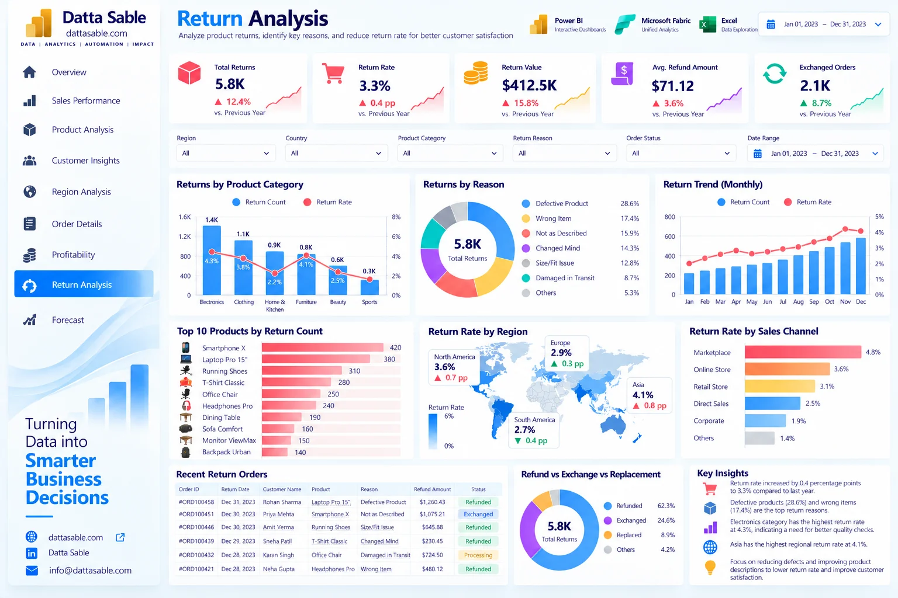

# Return Analysis Dashboard — Development & Implementation Guide

This document provides the complete technical and visual specification for **Page 08: Return Analysis Dashboard** of the **Enterprise Power BI Analytics Portfolio**.

---

## 1. Business Objective
Evaluate product returns, financial refund exposure, root-cause reason codes, resolution pathways, and post-purchase quality assurance.

---

## 2. Executive Questions Answered
- What is our enterprise return rate across all placed orders?
- What is the total financial refund exposure issued to customers?
- What are the primary drivers for returns (Defective, Wrong Item, Size, Dissatisfaction)?
- Which product categories experience the highest return rates?
- How are return cases resolved (Refund, Exchange, Store Credit)?

---

## 3. Dashboard Preview

*Figure 08: Return Analysis Dashboard design reference mockup (synthetic demonstration data).*

---

## 4. Key Performance Indicator (KPI) Definitions

| KPI Card | Target Value / Reconciled Benchmark | Bound DAX Measure | Business Description |
|---|---|---|---|
| **Returned Orders** | `5,800 orders` | `[Returned Orders]` | Orders resulting in a formal return |
| **Return Rate %** | `3.255% (~3.25%)` | `[Return Rate]` | Returned orders divided by total orders |
| **Total Refund Amount** | `$213,726.90` | `[Refund Amount]` | Direct cash refunds issued to customers |
| **Total Return Value** | `$414,222.16` | `[Return Value]` | Gross merchandise value of returned goods |
| **Average Refund** | `$36.85` | `[Average Refund]` | Mean refund amount per return event |

---

## 5. Visual Inventory & Build Matrix

The following visual specifications define the exact layout, chart types, data fields, and measure bindings for this report page:

| Visual Title | Power BI Visual Type | Axis / Rows / Legend | Values / Bound Measures | Interactions & Notes |
|---|---|---|---|---|

---

## 6. Required Source Tables
- [`fact_returns_2023`](../../data/data-dictionary.md#fact_returns_2023)
- [`fact_orders_2023`](../../data/data-dictionary.md#fact_orders_2023)
- [`dim_products`](../../data/data-dictionary.md#dim_products)
- [`DimDate`](../../data/data-dictionary.md#DimDate)

---

## 7. Field Mappings & Schema Requirements

- **Primary Date Field:** `DimDate[Date]` (or `fact_forecast_2024[Forecast_Month]` for Page 09)
- **Aggregation Dimensions:** Mapped directly from conformed dimensions (`dim_customers`, `dim_products`, `DimDate`).
- **Measures Storage:** All calculations referenced from the dedicated `_Measures` container.

---

## 8. DAX Measures Used on this Page

The following verified DAX measures from [`dax/measures/`](../../dax/measures/) drive this view:
- `[Returned Orders]`
- `[Return Rate]`
- `[Refund Amount]`
- `[Return Value]`
- `[Average Refund]`
- `[Refunded Cases]`
- `[Exchanged Cases]`

---

## 9. Filters & Slicers Configuration

- **Page Slicers:**
  - Return Reason (fact_returns_2023[Return_Reason])
  - Resolution (fact_returns_2023[Resolution])
  - Category
  - Date Range

---

## 10. Visual Interactions & Cross-Filtering Behavior

- **Edit Interactions:** All visuals set to **Filter** mode when interacting with bar charts and category tiles.
- **Cross-Highlighting:** Disabled on line charts to prevent low-contrast background bars.
- **Synchronized Slicers:** Date range and global regional slicers synchronize with other historical report pages.

---

## 11. Expected Analytical Insights
- Healthy 3.25% return rate falls well within acceptable retail benchmarks (3–5%).
- Total refund liability of $213.7K represents less than 1.7% of gross sales revenue.
- Defective Item and Wrong Size represent over 55% of return reasons, pinpointing clear QA and sizing guide opportunities.

---

## 12. Validation Requirements

- Verify all card values match the benchmark targets listed in Section 4.
- Sum of category / regional slices must reconcile exactly to the top-level total without duplication.
- Ensure automated test suite (`tests/`) passes before publishing.

---

## 13. Step-by-Step Implementation Instructions

1. **Create Page Canvas:** Add a new page in Power BI Desktop and name it `Return Analysis Dashboard`.
2. **Apply Visual Grid:** Configure a 16:9 canvas with `#F5F8FC` background and 16px page margins.
3. **Add Navigation Header:** Place the Datta Sable monogram logo and top navigation bar.
4. **Insert KPI Cards:** Place the top summary cards using Segoe UI 28pt bold callout values.
5. **Construct Charts:** Follow the Visual Inventory table in Section 5 to create and position each chart.
6. **Configure Interactions:** Select each visual, navigate to **Format > Edit Interactions**, and enforce single-direction filtering.
7. **Test Slicers:** Select various dates and segments to confirm responsive recalculation.

---

## 14. Known Limitations & Authenticity Notes

- Returns represent separate event logs; refund amounts are tracked in `fact_returns_2023` and not subtracted from gross order sales.
- Visual mockup depicted in Section 3 serves as an illustrative design benchmark; underlying dataset metrics are the authoritative source of truth.
