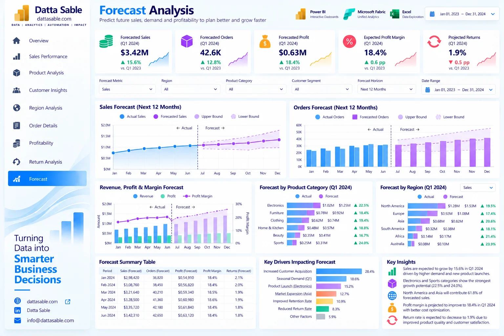

# Forecast Analysis Dashboard — Development & Implementation Guide

This document provides the complete technical and visual specification for **Page 09: Forecast Analysis Dashboard** of the **Enterprise Power BI Analytics Portfolio**.

---

## 1. Business Objective
Support executive planning, capacity budgeting, and revenue goal tracking for calendar year 2024 using monthly projections and confidence bounds.

---

## 2. Executive Questions Answered
- What is our projected annual revenue, order volume, and profit for 2024?
- What are the planning scenario ranges (conservative -12% vs optimistic +12% bounds)?
- How will seasonal holiday peaks impact Q4 inventory and warehouse capacity?
- What is the expected operating margin expansion across the 2024 forecast period?
- What return rate expectations should customer operations budget for?

---

## 3. Dashboard Preview

*Figure 09: Forecast Analysis Dashboard design reference mockup (synthetic demonstration data).*

---

## 4. Key Performance Indicator (KPI) Definitions

| KPI Card | Target Value / Reconciled Benchmark | Bound DAX Measure | Business Description |
|---|---|---|---|
| **Forecast 2024 Sales** | `$14,843,698.91 ($14.84M)` | `[Forecast Sales]` | Projected 2024 baseline revenue (+15.6% YoY) |
| **Forecast 2024 Profit** | `$2,749,548.22 ($2.75M)` | `[Forecast Profit]` | Projected 2024 operating profit |
| **Forecast 2024 Orders** | `201,010 orders` | `[Forecast Orders]` | Projected transaction volume |
| **Expected Margin %** | `18.52%` | `[Forecast Margin]` | Projected operating margin (expanding to 18.9% in Q4) |
| **Forecast Return Rate** | `2.80%` | `[Forecast Return Rate (weighted)]` | Budgeted return rate assumption |

---

## 5. Visual Inventory & Build Matrix

The following visual specifications define the exact layout, chart types, data fields, and measure bindings for this report page:

| Visual Title | Power BI Visual Type | Axis / Rows / Legend | Values / Bound Measures | Interactions & Notes |
|---|---|---|---|---|
| **Forecast KPI cards** | Cards | `Forecast period` | `[Forecast Sales], [Forecast Orders], [Forecast Profit], [Forecast Margin]` | 2024 only |
| **Forecast sales with bounds** | Line and shaded band | `fact_forecast_2024[Forecast_Month]` | `[Forecast Sales], [Forecast Sales Lower 95], [Forecast Sales Upper 95]` | Illustrative ±12% planning scenario bounds |
| **Forecast orders** | Column | `fact_forecast_2024[Forecast_Month]` | `[Forecast Orders]` | Monthly projections |
| **Forecast profit and margin** | Combo | `fact_forecast_2024[Forecast_Month]` | `[Forecast Profit], [Forecast Margin]` | Use weighted margin |
| **Category forecast** | Bar | `Product_Category (NOT IN FORECAST CSV)` | `Forecast sales by category` | Needs forecast allocation table; do not infer |
| **Regional forecast** | Bar | `Region (NOT IN FORECAST CSV)` | `Forecast sales by region` | Needs region-specific forecast table |
| **Forecast summary** | Matrix | `fact_forecast_2024[Forecast_Month]` | `[Forecast Sales], [Forecast Orders], [Forecast Profit], [Forecast Margin]` | Use full 12-month table |
| **Forecast drivers** | Bar | `Driver attribution (NOT PROVIDED)` | `Driver impact` | Requires modeled drivers and documentation |

---

## 6. Required Source Tables
- [`fact_forecast_2024`](../../data/data-dictionary.md#fact_forecast_2024)
- [`DimDate`](../../data/data-dictionary.md#DimDate)

---

## 7. Field Mappings & Schema Requirements

- **Primary Date Field:** `DimDate[Date]` (or `fact_forecast_2024[Forecast_Month]` for Page 09)
- **Aggregation Dimensions:** Mapped directly from conformed dimensions (`dim_customers`, `dim_products`, `DimDate`).
- **Measures Storage:** All calculations referenced from the dedicated `_Measures` container.

---

## 8. DAX Measures Used on this Page

The following verified DAX measures from [`dax/measures/`](../../dax/measures/) drive this view:
- `[Forecast Sales]`
- `[Forecast Orders]`
- `[Forecast Profit]`
- `[Forecast Margin]`
- `[Forecast Sales Lower 95]`
- `[Forecast Sales Upper 95]`

---

## 9. Filters & Slicers Configuration

- **Page Slicers:**
  - Scenario (fact_forecast_2024[Scenario])
  - Forecast Month (fact_forecast_2024[Forecast_Month])

---

## 10. Visual Interactions & Cross-Filtering Behavior

- **Edit Interactions:** All visuals set to **Filter** mode when interacting with bar charts and category tiles.
- **Cross-Highlighting:** Disabled on line charts to prevent low-contrast background bars.
- **Synchronized Slicers:** Date range and global regional slicers synchronize with other historical report pages.

---

## 11. Expected Analytical Insights
- 2024 projection reflects steady top-line growth to $14.84M, driven by retail channel expansion and customer retention.
- Q4 holiday seasonality represents the peak operating period, generating over $2.82M in combined November-December sales.
- Profit margin expands from 18.1% in Q1 to 18.9% in December due to operational efficiencies.

---

## 12. Validation Requirements

- Verify all card values match the benchmark targets listed in Section 4.
- Sum of category / regional slices must reconcile exactly to the top-level total without duplication.
- Ensure automated test suite (`tests/`) passes before publishing.

---

## 13. Step-by-Step Implementation Instructions

1. **Create Page Canvas:** Add a new page in Power BI Desktop and name it `Forecast Analysis Dashboard`.
2. **Apply Visual Grid:** Configure a 16:9 canvas with `#F5F8FC` background and 16px page margins.
3. **Add Navigation Header:** Place the Datta Sable monogram logo and top navigation bar.
4. **Insert KPI Cards:** Place the top summary cards using Segoe UI 28pt bold callout values.
5. **Construct Charts:** Follow the Visual Inventory table in Section 5 to create and position each chart.
6. **Configure Interactions:** Select each visual, navigate to **Format > Edit Interactions**, and enforce single-direction filtering.
7. **Test Slicers:** Select various dates and segments to confirm responsive recalculation.

---

## 14. Known Limitations & Authenticity Notes

- Projections represent company-level scenario planning baselines; macro-level projections do not segment by individual SKU or customer ID.
- Visual mockup depicted in Section 3 serves as an illustrative design benchmark; underlying dataset metrics are the authoritative source of truth.
